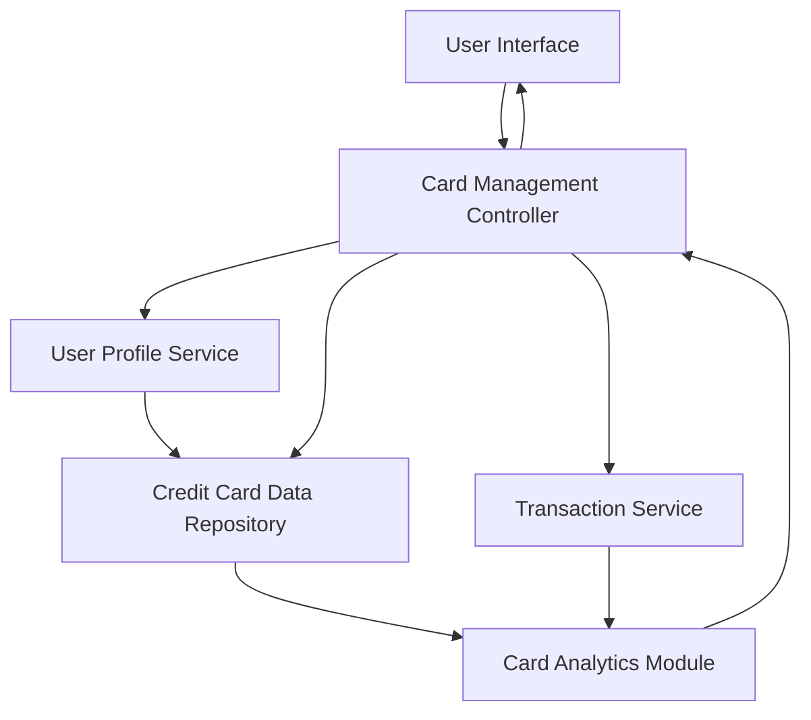

#### 1. High-Level Design

- **Summary:** This epic enables users to manage and monitor multiple credit cards (minimum 10 cards per user) from a unified interface. Users can view all their cards in one consolidated view, access card-specific details (individual credit limits, balances, spending patterns), perform card-wise spend analysis, and apply card selection and filtering to optimize their credit card portfolio usage.

- **Component Flow:**

- **Integration Points:**
  - **Upstream:** Credit card data repository (stores and retrieves card information including limits, balances, and masked card numbers)
  - **Upstream:** User profile service (manages card associations and user-card relationships)
  - **Upstream:** Transaction service (provides card-specific spending data for analysis)
  - **Internal:** Card Analytics Module (performs card-wise spend analysis and usage optimization calculations)

- **Key Assumptions:**
  - Card numbers are stored in encrypted format and displayed as masked (e.g., last 4 digits visible).
  - Card-wise spend analysis is calculated for the current billing cycle; billing cycle dates are stored per card in the credit card data repository.

- **NFR Highlights:** System must support minimum 10 credit cards per user; card data retrieval must complete within 1 second; must ensure secure storage and display of card information with masked card numbers.

- **Data Flow:** User accesses multi-card view → Card Management Controller retrieves user profile from User Profile Service → Controller fetches all associated cards from Credit Card Data Repository with masked card numbers → Transaction Service provides card-specific spending data → Card Analytics Module calculates card-wise spend analysis and usage patterns → User Interface displays consolidated card list with filtering and selection options → User selects specific card to view detailed information including individual credit limit, outstanding balance, and spending patterns.

#### 2. Validation Report

- **Requirements Coverage:** The design fully addresses all scope requirements including multiple credit card display, card-wise spend analysis, individual card details view, card selection and filtering, credit limit per card, and outstanding balance per card. All NFRs are satisfied: the architecture supports minimum 10 cards per user (scalable design); 1-second card data retrieval is achievable through optimized database queries and caching; security requirements are met through encrypted storage in Credit Card Data Repository and masked display in the UI. All integration dependencies with credit card data repository, user profile service, and transaction service are properly identified and integrated into the component flow.