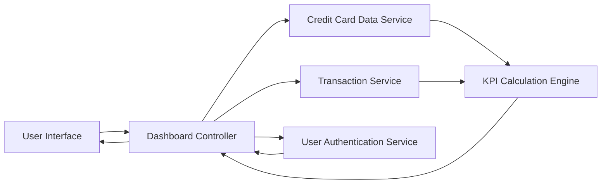

#### 1. High-Level Design

- **Summary:** This epic creates a consolidated dashboard that displays critical financial KPIs including monthly spending, total credit limit across all cards, available credit, and outstanding amounts. The dashboard provides real-time visibility into the user's credit utilization and financial health through a responsive, single-pane interface that supports both mobile and desktop viewports.

- **Component Flow:**

- **Integration Points:**
  - **Upstream:** Credit card data service (retrieves card balances, limits, and outstanding amounts)
  - **Upstream:** Transaction service (provides transaction data for monthly spend calculation)
  - **Upstream:** User authentication service (ensures secure access to dashboard)
  - **Internal:** KPI Calculation Engine (aggregates credit limits, calculates available credit and utilization metrics)

- **Key Assumptions:**
  - Monthly spend is calculated from the first day of the current calendar month to the current date.
  - Real-time data refresh occurs at configurable intervals (assumed every 5 minutes) rather than continuous streaming.

- **NFR Highlights:** Dashboard must load within 2 seconds; must support responsive design for mobile and desktop viewports; must handle real-time data refresh; must ensure data accuracy for all calculated metrics.

- **Data Flow:** User accesses dashboard → User Authentication Service validates credentials → Dashboard Controller requests card data from Credit Card Data Service and transaction data from Transaction Service → KPI Calculation Engine aggregates total credit limit, calculates available credit, and computes monthly spend → Dashboard Controller formats KPI data → User Interface renders responsive dashboard with real-time KPI visualizations.

#### 2. Validation Report

- **Requirements Coverage:** The design comprehensively addresses all stated scope elements including monthly spend display, total credit limit aggregation, available credit calculation, outstanding amount tracking, responsive dashboard layout, and KPI visualization components. All NFRs are covered: 2-second load time is achievable through optimized data fetching and caching strategies; responsive design is supported through the UI framework; real-time data refresh is handled by the Dashboard Controller; data accuracy is ensured through the KPI Calculation Engine with validation logic. All integration dependencies are clearly identified and mapped in the architecture.