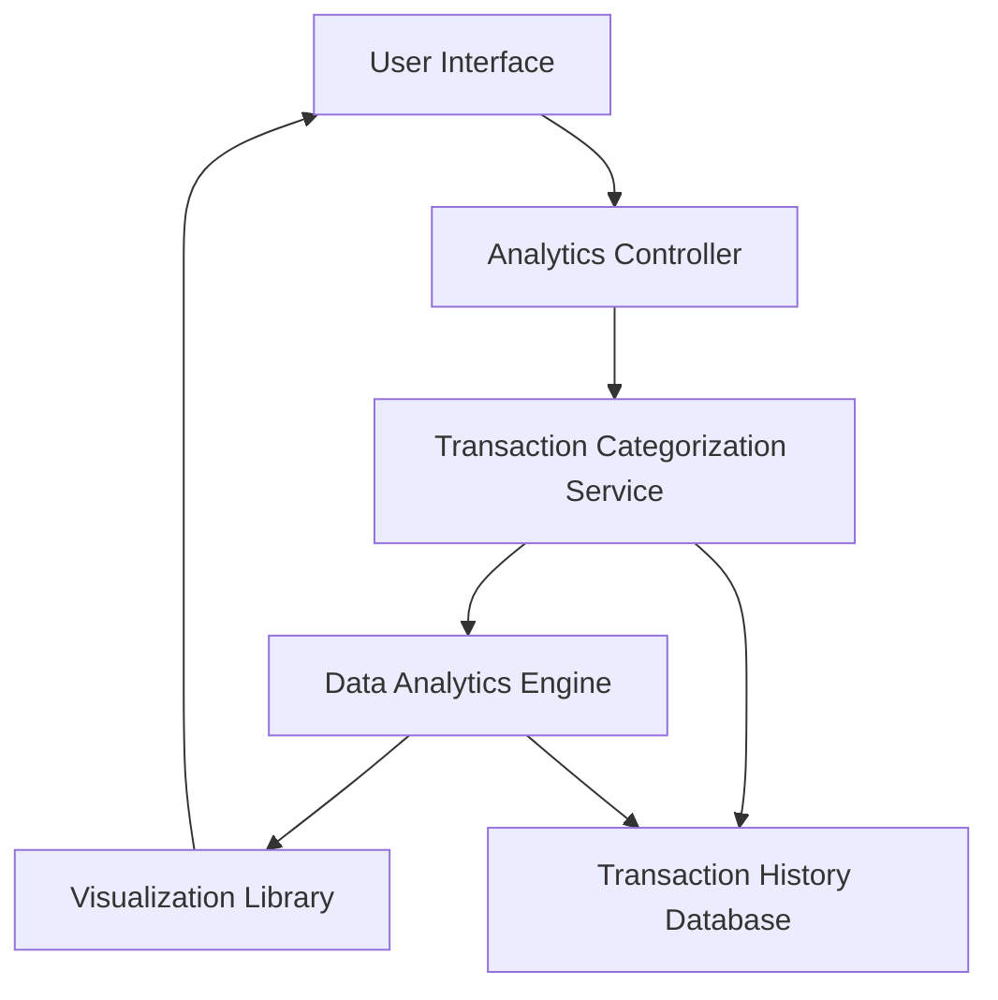

#### 1. High-Level Design

- **Summary:** This epic delivers an analytics module that enables users to visualize and analyze their credit card spending patterns across nine predefined categories (Food & Dining, Fuel, Shopping, Travel, Entertainment, Utilities, Healthcare, Education, Miscellaneous). The system aggregates transaction data, categorizes expenses, and presents interactive visualizations showing monthly trends and category-wise breakdowns to help users identify spending habits and optimization opportunities.

- **Component Flow:**

- **Integration Points:**
  - **Upstream:** Transaction categorization service (provides categorized transaction data)
  - **Upstream:** Transaction history database (stores historical transaction records up to 12 months)
  - **Internal:** Data analytics engine (performs aggregation and trend analysis)
  - **Internal:** Visualization library integration (renders charts and graphs)

- **Key Assumptions:**
  - Transactions are pre-categorized by the transaction categorization service into one of the nine predefined categories; manual recategorization is not supported.
  - Monthly spend trends are calculated based on transaction posting date, not transaction date.

- **NFR Highlights:** Analytics visualizations must render within 3 seconds; interactive chart interactions must respond in sub-second time; system must handle data aggregation for up to 12 months of transaction history.

- **Data Flow:** User requests analytics view → Analytics Controller fetches transaction data from Transaction History Database → Transaction Categorization Service categorizes transactions → Data Analytics Engine aggregates spending by category and time period → Visualization Library renders interactive charts and graphs → User Interface displays visual insights with filtering options (time period, category).

#### 2. Validation Report

- **Requirements Coverage:** The design fully covers the epic's stated scope including category-wise spending visualization, monthly spend trend analysis, interactive charts, support for nine spending categories, spending pattern identification, and data filtering by time period and category. All NFRs regarding rendering performance (3 seconds), interaction response time (sub-second), and data aggregation capacity (12 months) are addressed through appropriate component selection and architecture. Integration dependencies with transaction categorization service, data analytics engine, visualization library, and transaction history database are clearly mapped.