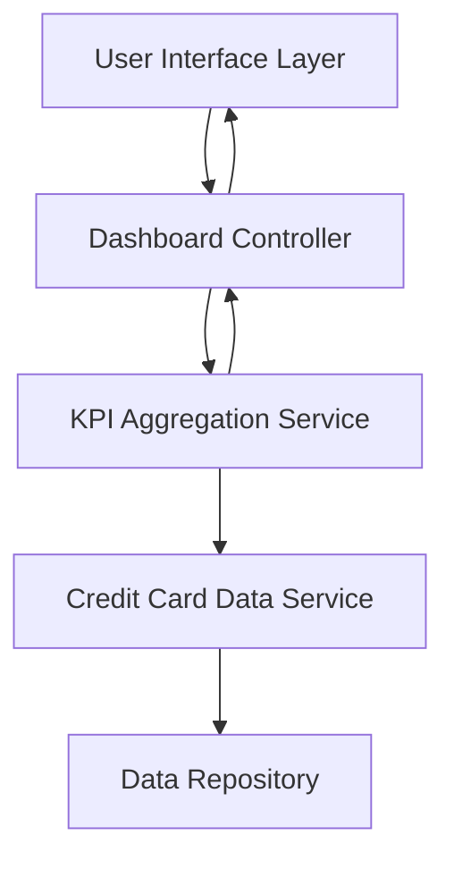

#### 1. High-Level Design

- **Summary:** This epic delivers a centralized dashboard that consolidates credit card portfolio metrics into a single view, displaying KPIs such as monthly spend, total credit limit, available credit, and outstanding amounts. The solution provides users with instant visibility into their financial health through a responsive, modern interface optimized for desktop, tablet, and mobile devices.

- **Component Flow:**

- **Integration Points:** 
  - Credit card data source or mock data service for retrieving card information, balances, and credit limits
  - Data repository containing credit card account details and transaction data

- **Key Assumptions:** 
  - Credit card data is available in near real-time or refreshed at regular intervals (e.g., hourly or daily batch updates)
  - KPI calculations (available credit, outstanding amounts) follow standard credit card business rules without complex edge cases

- **NFR Highlights:** Dashboard must be responsive across desktop, tablet, and mobile devices; page load time optimized for quick access; data displayed accurately and consistently across all views

#### 2. Validation Report

- **Requirements Coverage:** The design fully covers the epic's stated scope including dashboard KPI display, monthly spend tracking, credit limit aggregation, available credit calculation, outstanding amount tracking, and responsive layout. All NFRs related to responsiveness, performance, and data accuracy are addressed through the layered architecture with dedicated aggregation services and optimized data retrieval patterns.