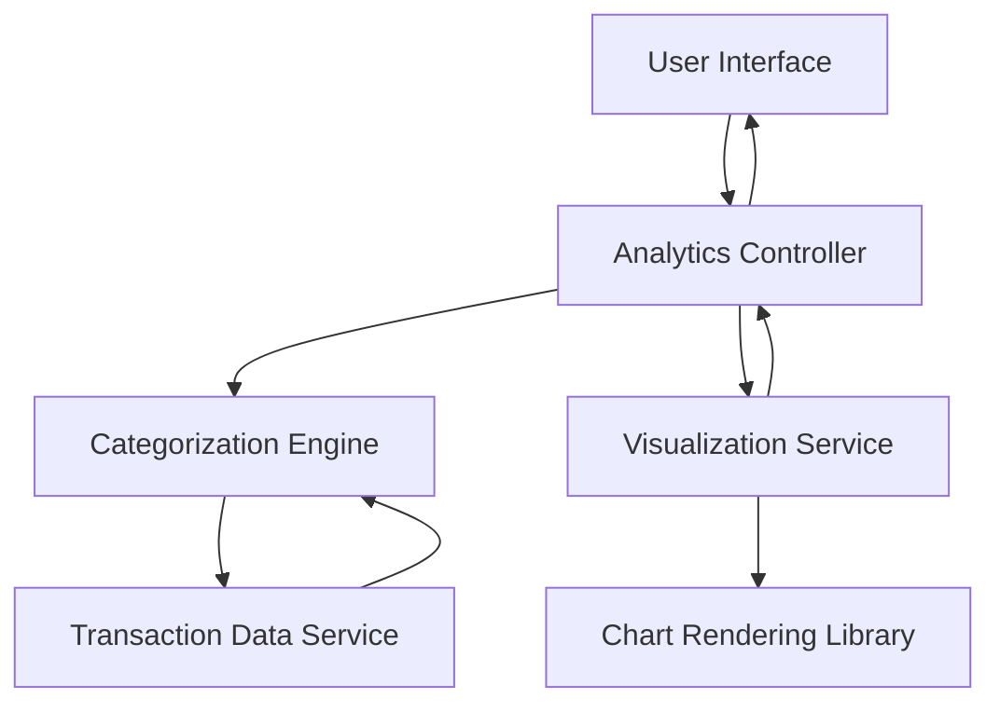

#### 1. High-Level Design

- **Summary:** This epic delivers analytical capabilities for users to understand spending behavior through interactive visualizations and trend analysis. The system provides category-wise spending breakdowns across nine predefined categories (Food & Dining, Fuel, Shopping, Travel, Entertainment, Utilities, Healthcare, Education, Miscellaneous) and monthly spend trend analysis, enabling data-driven budgeting and financial planning.

- **Component Flow:**

- **Integration Points:** 
  - Transaction data service for retrieving and categorizing transaction history
  - Charting library or visualization framework for rendering interactive charts and graphs
  - Transaction categorization engine (may be rule-based or ML-based)

- **Key Assumptions:** 
  - Transactions are pre-categorized or categorization rules/models are available to classify transactions into the nine predefined categories
  - Monthly trend analysis covers a rolling 12-month period by default for meaningful pattern identification

- **NFR Highlights:** Visualizations must render smoothly with responsive interactions; analytics calculations must be accurate and consistent; charts must be accessible and readable across different screen sizes

#### 2. Validation Report

- **Requirements Coverage:** The design fully addresses the epic's scope including category-wise spending visualization, monthly spend trends analysis, interactive charts and graphs, spending pattern identification, multi-category support across nine categories, and transaction categorization. The architecture separates categorization logic from visualization rendering, ensuring accuracy and smooth performance as required by the NFRs. The modular approach supports responsive chart rendering across different devices and maintains calculation consistency.