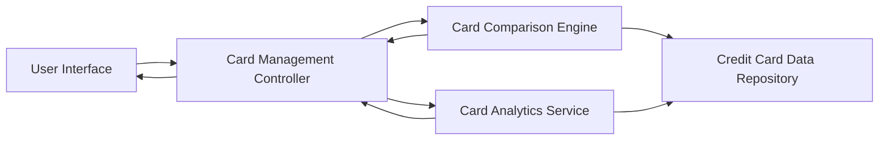

#### 1. High-Level Design

- **Summary:** This epic enables users to view and manage multiple credit cards within a unified interface, providing consolidated card display, card-wise spending analysis, detailed card information, comparison capabilities, and individual card performance tracking. The solution eliminates the need for users to access multiple platforms by presenting a holistic portfolio view.

- **Component Flow:**

- **Integration Points:** 
  - Credit card data repository or service for retrieving multiple card details and associated transaction data
  - Transaction data service for card-wise spending analysis

- **Key Assumptions:** 
  - Users may have between 1-10 credit cards on average; system designed to scale efficiently for this range
  - Card comparison uses standard metrics (APR, credit limit, rewards, fees) available in the card data model

- **NFR Highlights:** System must support display of multiple cards without performance degradation; card data must be rendered efficiently; interface must scale to accommodate varying numbers of cards per user

#### 2. Validation Report

- **Requirements Coverage:** The design comprehensively addresses all scope elements including multiple credit card display, card-wise spend analysis, card details view, card comparison functionality, and individual card performance tracking. The architecture separates concerns between card management, comparison, and analytics, ensuring scalability and performance as specified in the NFRs. The modular design supports efficient rendering and accommodates varying numbers of cards per user.