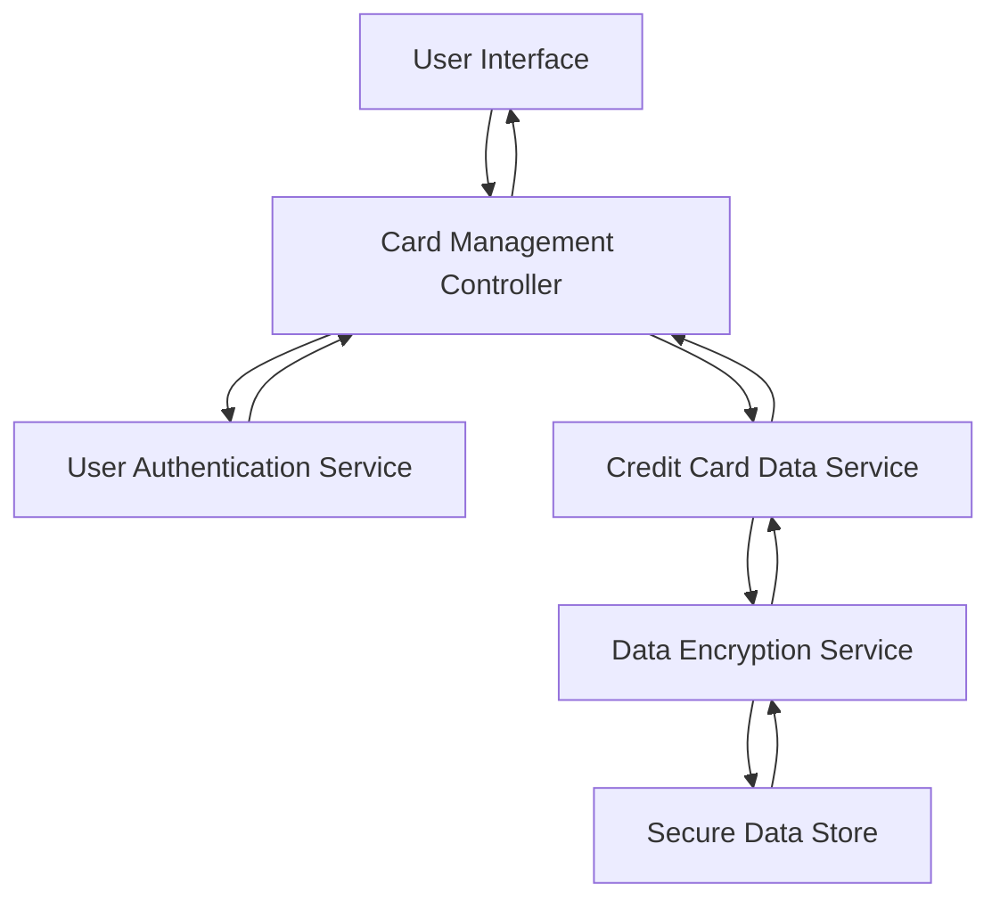

#### 1. High-Level Design

- **Summary:** This epic enables users to manage and view multiple credit cards within a unified dashboard interface. Users can register, view, and switch between multiple credit cards, accessing individual card details including credit limits, available credit, and outstanding balances for each card. The feature provides seamless navigation and comparison capabilities across the user's credit card portfolio.

- **Component Flow:**

- **Integration Points:**
  - **Upstream:** User Authentication Service (provides secure card access and user identity verification)
  - **Upstream:** Credit Card Data Service (retrieves and manages card information for multiple cards)
  - **Internal:** Data Encryption Service (ensures secure storage and encryption of sensitive card data)
  - **Downstream:** Secure Data Store (stores encrypted card details, limits, balances, and user-card associations)

- **Key Assumptions:**
  - Card data is encrypted at rest and in transit using industry-standard encryption protocols.
  - Users can register up to 10 credit cards per account with card details pre-validated before storage.

- **NFR Highlights:** System must support a minimum of 10 credit cards per user, card data must be securely stored and encrypted, and card switching must occur within 500ms.

- **Data Flow:** User logs in → User Authentication Service validates identity → User requests to view cards → Card Management Controller fetches card list from Credit Card Data Service → Data Encryption Service decrypts card data from Secure Data Store → Card list with individual details (credit limit, available credit, outstanding balance) is displayed → User selects a specific card → Card switching occurs within 500ms → Selected card's detailed information is displayed in User Interface.

#### 2. Validation Report

- **Requirements Coverage:** The design fully addresses all requirements including multiple card registration and display, card-wise credit limit view, card-wise available credit display, card-wise outstanding balance tracking, and card selection/switching interface. The architecture supports all NFR requirements for supporting minimum 10 cards per user, secure encrypted storage, and sub-500ms card switching performance. All integration dependencies (User Authentication Service, Credit Card Data Service, Data Encryption Service) are properly integrated into the component flow with appropriate security measures.