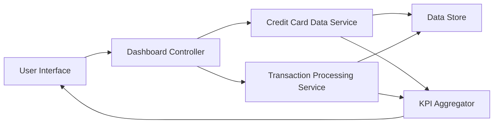

#### 1. High-Level Design

- **Summary:** This epic provides a consolidated dashboard that displays key performance indicators (KPIs) for the user's entire credit card portfolio. Users can view critical financial metrics including monthly spend, total credit limit, available credit, and outstanding amounts across all credit cards in a single unified interface. The dashboard provides real-time visibility into credit utilization and financial health to support informed spending decisions.

- **Component Flow:**

- **Integration Points:**
  - **Upstream:** Credit Card Data Service (retrieves card details, credit limits, and current balances)
  - **Upstream:** Transaction Processing Service (calculates monthly spend and outstanding amounts)
  - **Internal:** KPI Aggregator (consolidates data from multiple cards and computes portfolio-level metrics)
  - **Downstream:** User Interface (displays responsive dashboard with real-time KPI updates)

- **Key Assumptions:**
  - Credit Card Data Service and Transaction Processing Service provide near-real-time data updates to support the 2-second load requirement.
  - All credit cards are already registered and linked to the user's account for consolidated view.

- **NFR Highlights:** Dashboard must load within 2 seconds, support responsive design for mobile and desktop devices, and handle real-time data updates for multiple credit cards.

- **Data Flow:** User accesses dashboard → Dashboard Controller requests card details from Credit Card Data Service and transaction data from Transaction Processing Service → Data Store provides current balances, limits, and transaction history → KPI Aggregator consolidates data across all cards to compute total credit limit, available credit, monthly spend, and outstanding amounts → Aggregated KPIs are sent to User Interface → Dashboard displays consolidated view with real-time updates in responsive layout.

#### 2. Validation Report

- **Requirements Coverage:** The design comprehensively addresses all stated requirements including monthly spend display, total credit limit calculation, available credit tracking, outstanding amount display, multi-card consolidated view, and responsive dashboard layout. The architecture supports the NFR requirements for 2-second load time, responsive design for mobile and desktop, and real-time data updates. All integration dependencies (Credit Card Data Service, Transaction Processing Service) are properly incorporated into the component flow.