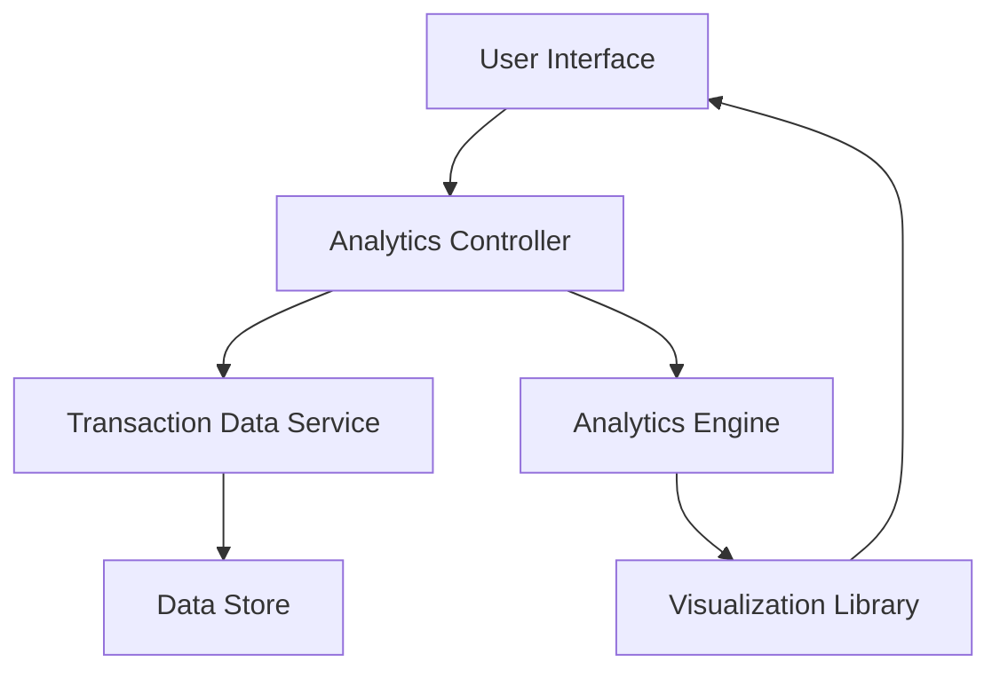

#### 1. High-Level Design

- **Summary:** This epic delivers a comprehensive spending analytics module that enables users to visualize and analyze their credit card spending patterns through interactive charts and graphs. The system processes transaction data to provide monthly spend trends, category-wise breakdowns across 9 predefined categories (Food & Dining, Fuel, Shopping, Travel, Entertainment, Utilities, Healthcare, Education, Miscellaneous), and card-wise spend analysis to help users make informed financial decisions.

- **Component Flow:**

- **Integration Points:**
  - **Upstream:** Transaction Data Service (provides transaction history and raw transaction data)
  - **Internal:** Analytics Engine (processes and categorizes transactions into predefined categories)
  - **Internal:** Visualization Library (renders interactive charts, graphs, and visual representations)
  - **Downstream:** User Interface (displays analytics dashboards and interactive visualizations)

- **Key Assumptions:**
  - Transaction data is already categorized or contains sufficient metadata for automatic categorization into the 9 predefined categories.
  - Historical transaction data for at least 12 months is available and accessible from the Transaction Data Service.

- **NFR Highlights:** Analytics visualizations must render within 3 seconds, support interactive filtering and drill-down capabilities, and handle historical data for a minimum of 12 months.

- **Data Flow:** User requests spending analytics → Analytics Controller fetches transaction history from Transaction Data Service → Analytics Engine processes and categorizes transactions by month, category, and card → Processed data is formatted for visualization → Visualization Library renders interactive charts (monthly trends, category breakdowns, card-wise analysis) → User Interface displays visualizations with interactive filtering and drill-down capabilities.

#### 2. Validation Report

- **Requirements Coverage:** The design fully covers the epic's stated scope including monthly spend trend visualization, category-wise spending analysis across 9 predefined categories, card-wise spend breakdown, and interactive charts. The architecture supports the NFR requirements for 3-second rendering, interactive filtering, and 12-month historical data handling. All integration dependencies (Transaction Data Service, Analytics Engine, Visualization Library) are accounted for in the component flow.