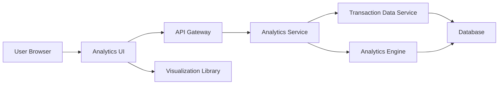

#### 1. High-Level Design

- **Summary:** This epic delivers comprehensive spending analytics and visualization capabilities to help users understand spending patterns and financial behavior. Users can access interactive visualizations for category-wise spending breakdowns across nine predefined categories (Food & Dining, Fuel, Shopping, Travel, Entertainment, Utilities, Healthcare, Education, Miscellaneous), monthly spend trend analysis, and transaction-level visibility for detailed purchase insights.

- **Component Flow:**

- **Integration Points:** 
  - **Upstream:** Transaction data service (for retrieving transaction history), Analytics engine (for processing and categorizing spending data)
  - **Downstream:** Visualization library (for rendering interactive charts on client-side), Credit card data service (for card-specific filtering)

- **Key Assumptions:** 
  - Transaction categorization is performed by the analytics engine using predefined rules or ML models; categories are fixed to the nine specified types.
  - Historical data retention policy supports minimum 12 months of transaction history for trend analysis.

- **NFR Highlights:** Analytics visualizations must render within 3 seconds; support historical data for minimum 12 months; interactive and responsive charts across all devices; maintain category classification accuracy for all transactions.

- **Data Flow:** User accesses the analytics dashboard and selects time period and card filters. The Analytics Service retrieves raw transaction data from the Transaction Data Service. The Analytics Engine processes transactions, applies category classification logic, and aggregates spending by category and time period. Processed analytics data (category totals, monthly trends, transaction details) is returned to the UI via API Gateway. The client-side Visualization Library renders interactive charts and graphs within 3 seconds. User interactions (drill-downs, filter changes) trigger new analytics requests with updated parameters. Historical data for 12+ months is maintained in the database to support trend analysis.

#### 2. Validation Report

- **Requirements Coverage:** The design fully addresses all scope requirements including category-wise spending visualization across nine predefined categories, monthly spend trends, interactive charts and graphs, transaction history view, spending pattern analysis, and time-based spending comparisons. All NFRs are covered: 3-second visualization rendering (achieved through optimized data aggregation and client-side rendering), 12+ months historical data support (database retention policy), interactive and responsive charts (visualization library selection), and category classification accuracy (analytics engine with validation rules). Integration dependencies with transaction data service, analytics engine, and visualization library are properly identified and incorporated into the architecture.