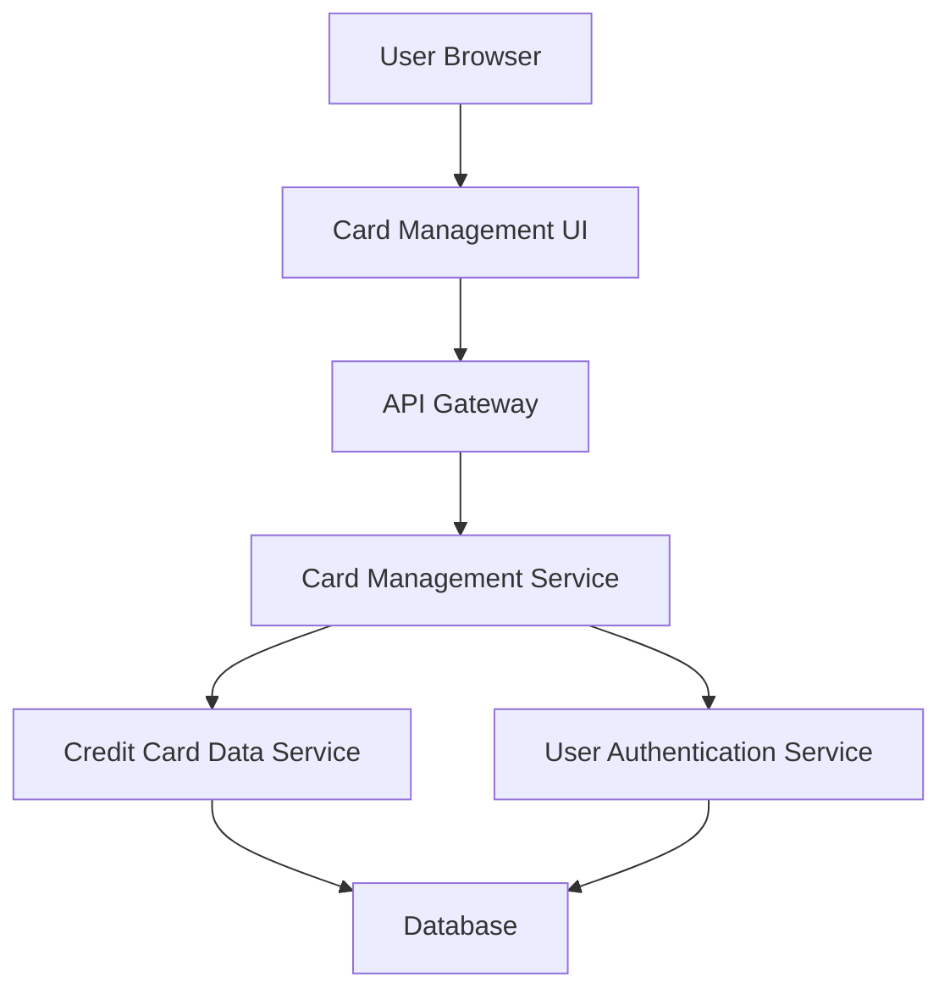

#### 1. High-Level Design

- **Summary:** This epic enables users to manage and monitor multiple credit cards within a single interface. Users can view all registered cards, access card-specific details (credit limits, balances, card information), switch between cards, and view card-wise spending analysis and transaction history. The centralized approach eliminates the need for multiple banking portals.

- **Component Flow:**

- **Integration Points:** 
  - **Upstream:** Credit card data service (for multi-card information retrieval), User authentication service (for card ownership verification and data isolation)
  - **Downstream:** Transaction service (for card-specific transaction history), Spending analytics service (for card-wise spend analysis)

- **Key Assumptions:** 
  - Card ownership is verified through user authentication tokens; cards are pre-registered in the system.
  - Card switching triggers a context change that filters all subsequent data requests to the selected card ID.

- **NFR Highlights:** System must support minimum 10 credit cards per user; card switching within 500ms; data isolation between cards; clear UI distinction between cards.

- **Data Flow:** User authenticates and the User Authentication Service validates card ownership. The Card Management Service retrieves all registered cards for the user from the Credit Card Data Service. The UI displays all cards with visual distinction. When a user selects a specific card, the Card Management Service updates the user context and retrieves card-specific details (limits, balances, transaction history) filtered by card ID. Card switching occurs client-side with cached data or via fast API calls (<500ms) to maintain responsive experience. Data isolation is enforced at the service layer by validating card ownership on every request.

#### 2. Validation Report

- **Requirements Coverage:** The design comprehensively addresses all scope elements including multiple credit card display, card-wise spend analysis, individual card details view, card selection and switching functionality, and card-specific credit limit and balance tracking. All NFRs are covered: support for 10+ cards per user (scalable data model), sub-500ms card switching (client-side context management with optimized API calls), data isolation (enforced at service layer with ownership verification), and clear UI distinction (addressed through UI component design). Integration dependencies with credit card data service and user authentication service are properly incorporated.