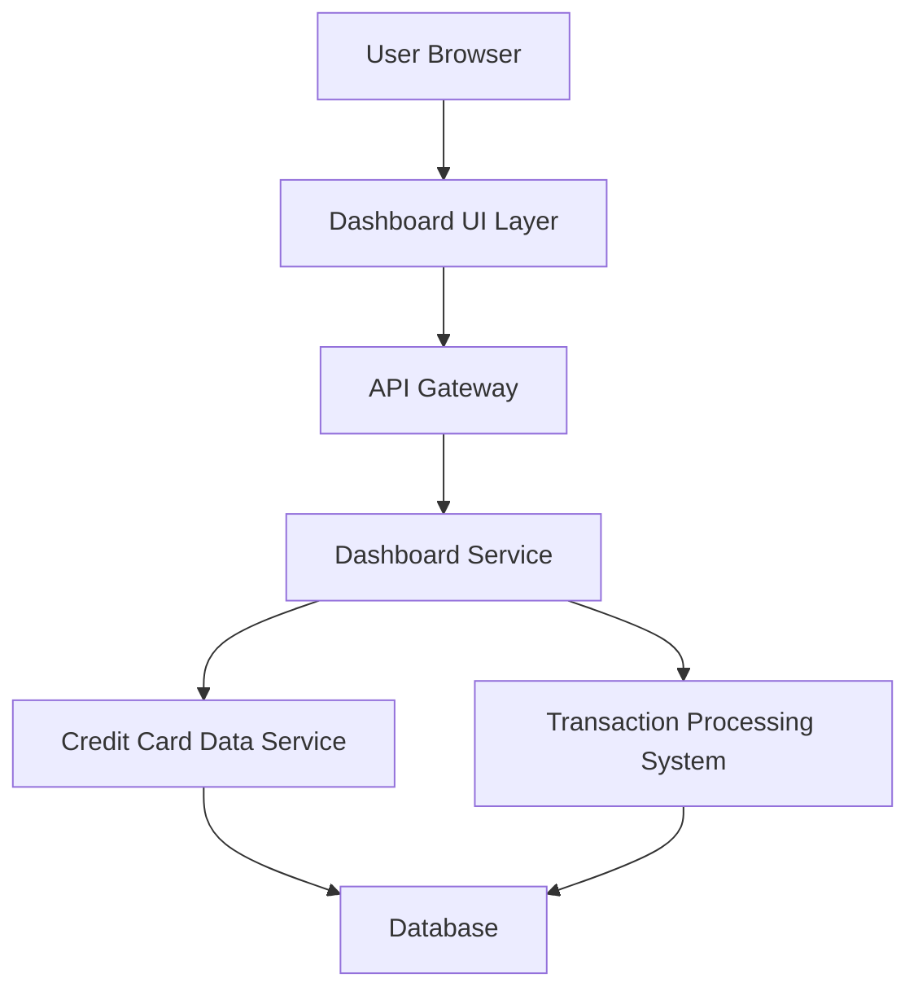

#### 1. High-Level Design

- **Summary:** This epic delivers a consolidated credit card portfolio dashboard that displays key performance indicators including monthly spend, total credit limit, available credit, and outstanding amounts. The dashboard provides real-time visibility into the user's overall credit health across all cards in a unified interface, enabling informed financial decision-making and effective credit utilization management.

- **Component Flow:**

- **Integration Points:** 
  - **Upstream:** Credit card data service (for retrieving card information and balances), Transaction processing system (for calculating monthly spend and outstanding amounts)
  - **Downstream:** User authentication service (implied for user session management), Responsive UI framework for multi-device support

- **Key Assumptions:** 
  - Monthly spend is calculated based on the current calendar month (first day to current date).
  - Real-time data refresh occurs via polling mechanism at configurable intervals or event-driven updates.

- **NFR Highlights:** Dashboard must load within 2 seconds; real-time data refresh support; responsive design for desktop, tablet, and mobile; 100% data accuracy for financial calculations.

- **Data Flow:** User authenticates and accesses the dashboard UI. The Dashboard Service aggregates data from the Credit Card Data Service (card details, limits, balances) and Transaction Processing System (monthly spend, outstanding amounts). Financial calculations are performed server-side to ensure accuracy. Aggregated KPIs are returned to the UI layer via API Gateway and rendered in the responsive dashboard layout. Real-time updates are pushed or polled to maintain current data state.

#### 2. Validation Report

- **Requirements Coverage:** The design fully covers the epic's stated scope including monthly spend display, total credit limit calculation, available credit tracking, outstanding amount monitoring, multi-card consolidated view, and responsive dashboard layout. All NFRs (2-second load time, real-time refresh, responsive design, 100% financial accuracy) are addressed through appropriate architectural choices (server-side calculations, caching strategies, responsive UI framework). Integration dependencies with credit card data service and transaction processing system are clearly identified and incorporated into the component flow.