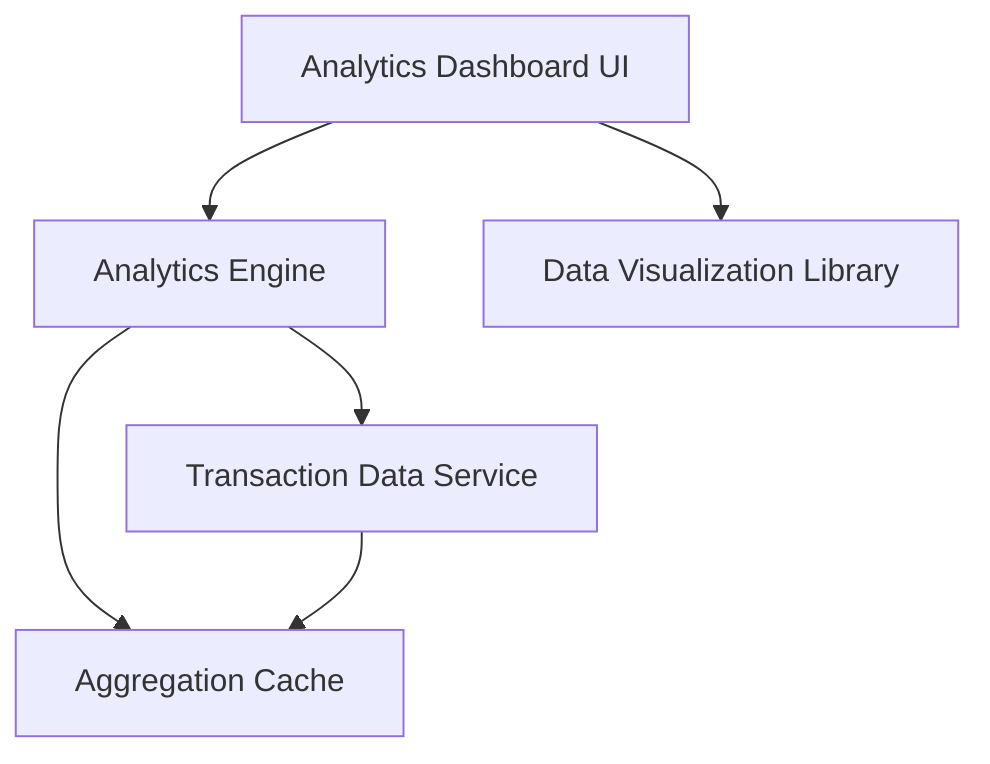

#### 1. High-Level Design

- **Summary:** This epic provides comprehensive spending analytics through interactive visualizations across nine predefined categories (Food & Dining, Fuel, Shopping, Travel, Entertainment, Utilities, Healthcare, Education, Miscellaneous). Users can analyze monthly spend trends over 12 months with drill-down capabilities, helping identify spending patterns and optimization opportunities.

- **Component Flow:**

- **Integration Points:**
  - **Upstream:** Transaction data service for retrieving categorized transaction data
  - **Internal:** Analytics engine for processing and aggregating spending data across categories and time periods
  - **External:** Data visualization library (e.g., Chart.js, D3.js) for rendering interactive charts and graphs

- **Key Assumptions:**
  - Transactions are pre-categorized into the nine spending categories by the transaction data service
  - 12-month historical data is retained and indexed for efficient time-based queries

- **NFR Highlights:** Visualizations must render within 3 seconds, support up to 12 months of transaction history, interactive drill-down capabilities, data aggregation accurate to 2 decimal places

- **Data Flow:** User accesses analytics dashboard → Analytics Engine checks Aggregation Cache for pre-computed category and trend data → If cache miss, engine queries Transaction Data Service for categorized transactions over selected time period (up to 12 months) → Engine aggregates spending by category and calculates monthly trends with 2-decimal precision → Aggregated data is cached and passed to Analytics Dashboard UI → UI uses Data Visualization Library to render interactive charts (category breakdown, monthly trends) → User interactions (drill-down, time period selection) trigger re-aggregation via Analytics Engine → Updated visualizations render within 3 seconds

#### 2. Validation Report

- **Requirements Coverage:** The design fully addresses all scope elements including category-wise spending visualization, monthly spend trends, interactive charts and graphs, spending pattern analysis, category breakdown across nine categories, and time-based trend analysis. All NFRs are incorporated: 3-second rendering via caching and efficient aggregation, 12-month history support in data service, interactive drill-down via visualization library capabilities, and 2-decimal accuracy in aggregation logic. Integration dependencies (transaction data service, analytics engine, visualization library) are reflected in the component architecture.