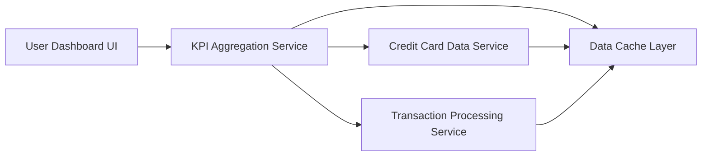

#### 1. High-Level Design

- **Summary:** This epic delivers a consolidated dashboard displaying key performance indicators across all user credit cards. Users can view aggregated metrics including monthly spend, total credit limit, available credit, and outstanding amounts in a responsive, accessible interface that loads within 2 seconds.

- **Component Flow:**

- **Integration Points:**
  - **Upstream:** Credit card data service for retrieving card information (limits, status, card details)
  - **Upstream:** Transaction processing service for calculating monthly spend and outstanding amounts
  - **Internal:** Data cache layer for near real-time data refresh and performance optimization

- **Key Assumptions:**
  - KPI calculations are performed server-side and cached to meet 2-second load requirement
  - "Near real-time" data refresh is interpreted as updates within 5-10 minutes for non-transactional data

- **NFR Highlights:** Dashboard must load within 2 seconds, responsive design for mobile and desktop, near real-time data refresh, WCAG 2.1 accessibility compliance

- **Data Flow:** User accesses dashboard → KPI Aggregation Service checks Data Cache Layer for recent metrics → If cache miss or stale, service fetches card details from Credit Card Data Service and transaction data from Transaction Processing Service → Service aggregates monthly spend, total limits, available credit, and outstanding amounts across all cards → Aggregated KPIs are cached and returned to Dashboard UI → UI renders responsive, accessible dashboard with consolidated metrics → Cache is refreshed periodically for near real-time updates

#### 2. Validation Report

- **Requirements Coverage:** The design comprehensively addresses all stated requirements including monthly spend display, total credit limit calculation, available credit tracking, outstanding amount monitoring, responsive dashboard layout, and multi-card KPI aggregation. All NFRs are explicitly addressed: 2-second load time via caching strategy, responsive design in UI layer, near real-time refresh via cache mechanism, and WCAG 2.1 compliance in UI implementation. Integration dependencies (credit card data service, transaction processing service) are incorporated into the architecture.