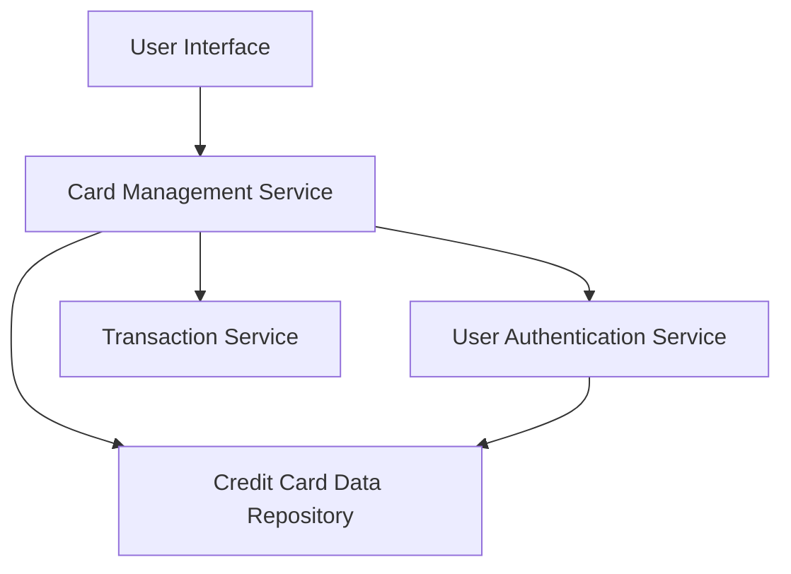

#### 1. High-Level Design

- **Summary:** This epic enables users to view and manage multiple credit cards (up to 10 per user) within a unified interface. Users can view individual card details, track card-specific spending, compare credit utilization across cards, and analyze performance metrics for each card in their portfolio.

- **Component Flow:**

- **Integration Points:**
  - **Upstream:** User authentication service for verifying card ownership and user identity
  - **Internal:** Credit card data repository for storing and retrieving card information
  - **Internal:** Transaction service for retrieving card-specific spending data and metrics

- **Key Assumptions:**
  - Card data is pre-registered in the system; this epic handles viewing/management only, not card onboarding
  - Card metrics are calculated and cached periodically by the transaction service for performance optimization

- **NFR Highlights:** System must support at least 10 credit cards per user, card data retrieval must complete within 1 second, interface must maintain performance with multiple cards loaded simultaneously

- **Data Flow:** User authenticates and requests card portfolio view → Card Management Service validates user identity via Authentication Service → Service retrieves all registered cards from Credit Card Data Repository → For each card, spending metrics are fetched from Transaction Service → Aggregated card data (details, limits, balances, utilization) is returned to UI → User can filter, select, and compare cards; drilling down into individual card triggers detailed spend analysis from Transaction Service

#### 2. Validation Report

- **Requirements Coverage:** The design fully covers the epic's stated scope including multiple card display, card registration view, card-wise spend analysis, individual card metrics, card comparison capabilities, and card selection/filtering. All NFRs (10 cards per user, 1-second retrieval, performance maintenance) are addressed through service architecture and data repository design. Integration dependencies (authentication, card repository, transaction service) are incorporated into the component flow.