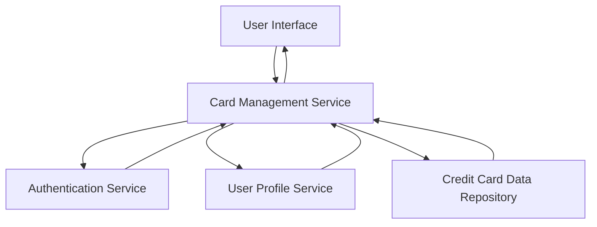

#### 1. High-Level Design

- **Summary:** This epic enables users to manage and view multiple credit cards (minimum 10 per user) within a single interface. Users can view all registered cards, access card-specific details, analyze card-wise spending, and compare usage patterns. The feature provides intuitive navigation between cards with fast switching performance (under 500ms) while maintaining data consistency and security.

- **Component Flow:**

- **Integration Points:**
  - **Upstream:** User profile service (validates card ownership and user-card associations)
  - **Upstream:** Credit card data repository (stores and retrieves card details, limits, and spending information)
  - **Upstream:** Authentication and authorization service (ensures secure access to card information)

- **Key Assumptions:**
  - Card data is pre-loaded or cached to achieve sub-500ms card switching response time.
  - User-card associations are maintained in the user profile service with real-time synchronization.

- **NFR Highlights:** System must support minimum 10 credit cards per user, card switching response time under 500ms, maintain data consistency across card views, and ensure secure card information display.

#### 2. Validation Report

- **Requirements Coverage:** The design addresses all functional requirements including multiple credit card display, card-wise spend analysis, individual card details view, card selection and filtering, card status indicators, and card limit tracking per card. The architecture supports the NFR requirements through caching mechanisms for fast card switching, integration with user profile service for ownership validation, and secure data handling. The design accommodates at least 10 cards per user as specified.