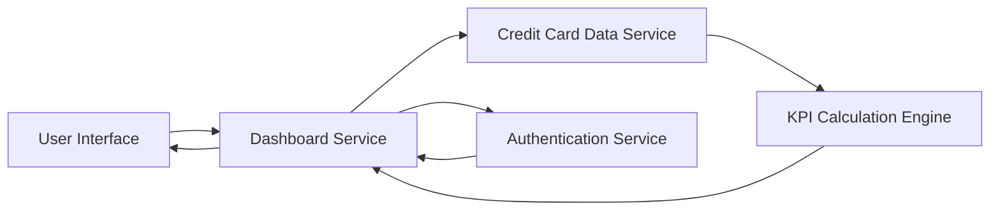

#### 1. High-Level Design

- **Summary:** This epic delivers a consolidated dashboard that displays key performance indicators (KPIs) for the user's credit card portfolio, including monthly spend, total credit limit, available credit, and outstanding amounts. The dashboard provides real-time visibility into overall credit card financial health through a modern, responsive interface accessible across desktop and mobile devices.

- **Component Flow:**

- **Integration Points:**
  - **Upstream:** Credit card data source or mock data service (provides card transaction and account data)
  - **Upstream:** User authentication service (validates user identity and authorizes access to card information)
  - **Internal:** KPI calculation engine (aggregates and computes financial metrics)

- **Key Assumptions:**
  - Credit card data is available via REST API or similar service interface with standardized data format (JSON).
  - KPI calculations are performed server-side with caching to meet the 2-second load time requirement.

- **NFR Highlights:** Dashboard must load within 2 seconds, support responsive design across desktop and mobile devices, handle real-time data updates for KPIs, and support concurrent viewing by multiple users.

#### 2. Validation Report

- **Requirements Coverage:** The design covers all stated requirements including monthly spend display, total credit limit calculation, available credit tracking, outstanding amount visibility, multi-card consolidated view, responsive dashboard layout, and KPI widgets. The architecture supports the specified NFRs through caching strategies, responsive UI framework, and scalable service design. Authentication integration ensures secure access as required.