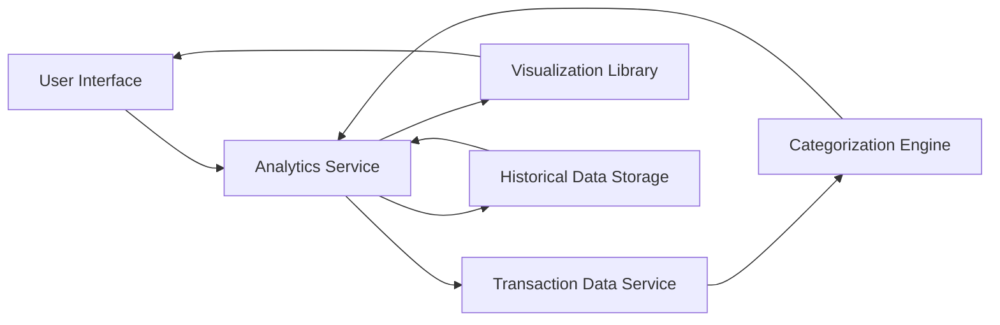

#### 1. High-Level Design

- **Summary:** This epic delivers interactive visualizations and analytics capabilities enabling users to understand spending patterns across nine predefined categories (Food & Dining, Fuel, Shopping, Travel, Entertainment, Utilities, Healthcare, Education, Miscellaneous) and time periods. The module provides monthly spend trend analysis, category-wise breakdowns, and visual representations through charts and graphs, supporting historical data analysis for at least 12 months.

- **Component Flow:**

- **Integration Points:**
  - **Upstream:** Transaction data service (provides raw transaction data for analysis)
  - **Upstream:** Categorization engine or service (classifies transactions into nine predefined categories)
  - **Upstream:** Historical transaction storage (stores at least 12 months of transaction history)
  - **Internal:** Data visualization library (renders interactive charts and graphs)

- **Key Assumptions:**
  - Transaction categorization is automated using rule-based or ML-based categorization engine with predefined category mappings.
  - Analytics data is pre-aggregated and cached to meet the 3-second rendering requirement for visualizations.

- **NFR Highlights:** Analytics visualizations must render within 3 seconds, support interactive filtering and drill-down capabilities, handle historical data for at least 12 months, and maintain data accuracy for category classification.

#### 2. Validation Report

- **Requirements Coverage:** The design comprehensively covers all stated requirements including category-wise spending visualization, monthly spend trend analysis, interactive charts and graphs, spending pattern identification, nine predefined spending categories, transaction categorization, and visual analytics dashboard. The architecture supports NFRs through pre-aggregation strategies for fast rendering, integration with categorization engine for accurate classification, and historical data storage for 12-month analysis. Interactive filtering and drill-down capabilities are enabled through the visualization library integration.