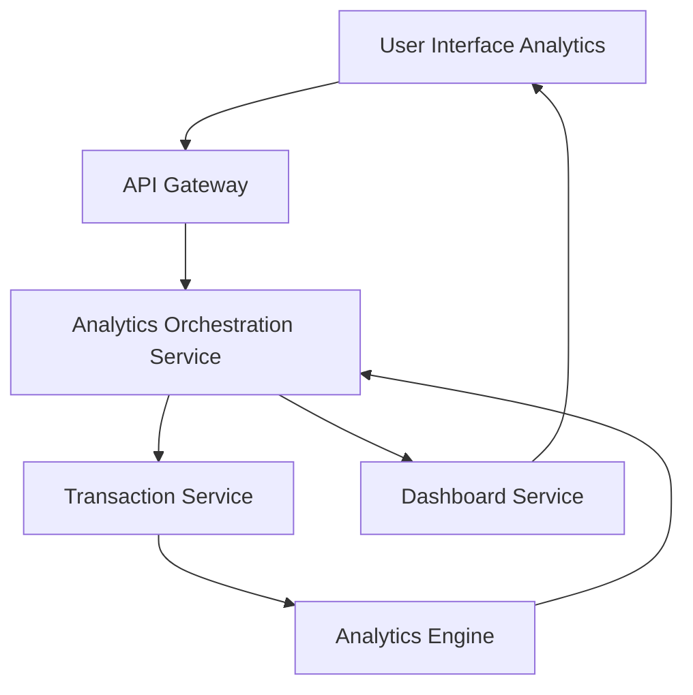

### 1. High-Level Design

**Summary:**  
This epic delivers analytics capabilities that provide users with actionable insights into spending behavior through interactive visualizations. Users can analyze spending patterns across predefined categories (Food & Dining, Fuel, Shopping, Travel, Entertainment, Utilities, Healthcare, Education, Miscellaneous) and view monthly spend trends. Interactive charts and graphs enable drill-down into specific categories and time periods for data-driven budget decisions.

**Component Flow:**

**Integration Points:**
- **Upstream Systems:**
  - Transaction Service (provides transaction data with category tags for analysis)
  - Analytics Engine (processes and aggregates transaction data, computes trends and category breakdowns)
  - Dashboard Service (renders visualizations, charts, and interactive graphs)
- **Downstream Systems:**
  - Analytics UI (displays category-wise breakdowns, trend charts, and interactive filters)

**Key Assumptions:**
- Transaction categorization is performed by the Transaction Service prior to analytics processing; categories are standardized and consistent.
- Monthly trend analysis covers the current month and a configurable number of prior months (default assumed as 12 months) based on available transaction history.

**NFR Highlights:**  
Analytics visualizations must render within 3 seconds, support interactive filtering with response time under 1 second, handle up to 1000 transactions per month per user, and ensure data accuracy in calculations and aggregations.

### 2. Validation Report

**Requirements Coverage:**  
The design fully addresses the epic's scope including category-wise spending breakdown, monthly spend trends visualization, interactive charts and graphs, spending pattern analysis, category filtering, time-based trend analysis, and visual spending comparisons. All NFRs (3-second rendering, sub-1-second filtering, 1000 transactions/month capacity, data accuracy) are accounted for in the architecture. Dependencies on Transaction Service, Analytics Engine, and Dashboard Service are clearly mapped and integrated into the component flow.