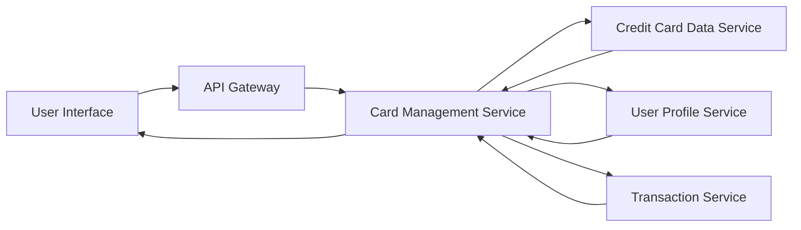

### 1. High-Level Design

**Summary:**  
This epic enables users to manage and monitor multiple credit cards from a unified interface. Users can view all their credit cards, switch between cards seamlessly, and access card-specific information including credit limits, available credit, outstanding balances, and card-wise spend analysis. The feature optimizes card portfolio management by consolidating multi-card data in one place.

**Component Flow:**

**Integration Points:**
- **Upstream Systems:**
  - Credit Card Data Service (provides card information, balances, credit limits)
  - User Profile Service (manages card-to-user associations and user preferences)
  - Transaction Service (supplies card-wise transaction data for spend analysis)
- **Downstream Systems:**
  - Multi-card UI (displays card list, card details, and card-specific analytics)

**Key Assumptions:**
- Card associations are pre-established in User Profile Service; no runtime card linking/unlinking is required within this epic.
- Card-wise spend analysis aggregates transactions by card identifier; transaction categorization is handled by the Transaction Service.

**NFR Highlights:**  
System must support minimum 10 credit cards per user, card switching response time under 500ms, maintain data consistency across all card views, and ensure secure card data handling with encryption at rest and in transit.

### 2. Validation Report

**Requirements Coverage:**  
The design comprehensively addresses the epic's scope including multiple credit card display, card-wise spend analysis, individual card details view, card selection/switching functionality, card-specific balance tracking, and credit utilization per card. All NFRs (10-card minimum support, sub-500ms switching, data consistency, encryption) are incorporated. Dependencies on Credit Card Data Service, User Profile Service, and Transaction Service are explicitly defined and integrated into the component flow.