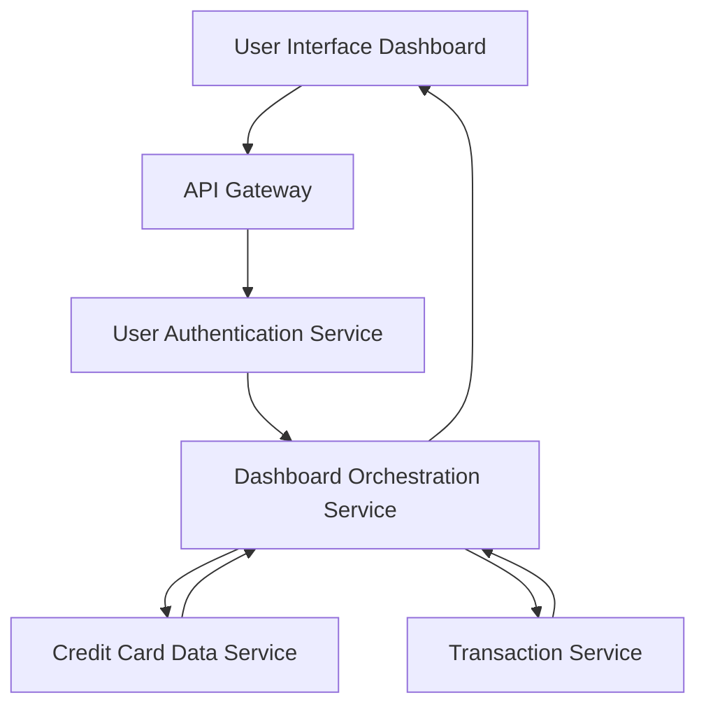

### 1. High-Level Design

**Summary:**  
This epic delivers a comprehensive dashboard that aggregates and displays key financial metrics across all user credit cards, including monthly spend, total credit limit, available credit, and outstanding amounts. The dashboard provides real-time visibility into credit card financial health through a consolidated KPI interface, enabling users to quickly assess their financial position.

**Component Flow:**

**Integration Points:**
- **Upstream Systems:**
  - User Authentication Service (secure access and user identity verification)
  - Credit Card Data Service (retrieves card details, balances, credit limits)
  - Transaction Service (calculates monthly spend from transaction data)
- **Downstream Systems:**
  - Dashboard UI (renders KPIs and financial metrics)

**Key Assumptions:**
- Credit Card Data Service provides real-time or near-real-time data with sufficient freshness for dashboard display.
- Monthly spend is calculated based on transaction posting date within the current calendar month; timezone handling defaults to user's profile timezone.

**NFR Highlights:**  
Dashboard must load within 2 seconds, support responsive layouts (desktop/tablet/mobile), handle up to 10 credit cards per user, and ensure 99.9% uptime with data accuracy.

### 2. Validation Report

**Requirements Coverage:**  
The design fully covers the epic's stated scope including monthly spend calculation, credit limit aggregation, available credit computation, outstanding amount tracking, consolidated KPI view, and real-time data refresh. All specified NFRs (2-second load time, responsive design, 10-card support, 99.9% uptime) are addressed through the architecture. Integration dependencies with Credit Card Data Service, Transaction Service, and User Authentication Service are clearly mapped.