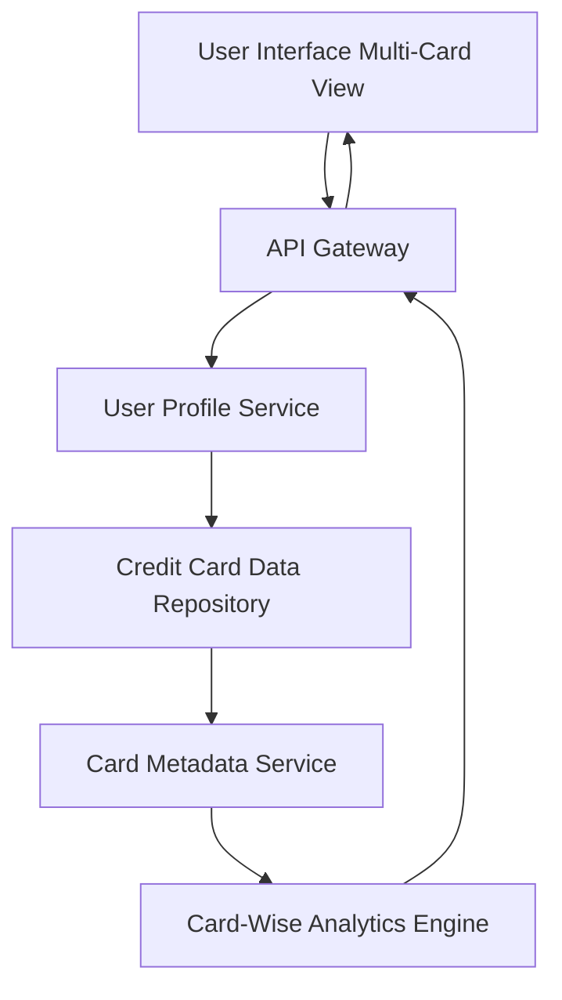

#### 1. High-Level Design

- **Summary**: This epic enables users to manage and monitor multiple credit cards from a unified interface. Users can view all their credit cards in a consolidated view, access card-specific details, perform card-wise spend analysis, switch between cards, and compare spending patterns across different cards, providing holistic credit card portfolio management without accessing multiple banking portals.

- **Component Flow**:

- **Integration Points**:
  - **Upstream Systems**: Credit card data repository (stores and provides access to all credit card account and transaction data), User profile service (manages user-to-card associations and user preferences), Card metadata service (provides card details such as card type, issuer, branding)
  - **Downstream Systems**: Card-Wise Analytics Engine (processes and calculates individual card financial metrics and spending analysis)

- **Key Assumptions**: 
  - User-to-card associations are pre-established and maintained by the User Profile Service; adding new external bank cards is out of scope
  - Card data format is standardized across all cards in the repository; minimum support for 10 cards per user as specified in NFRs

- **NFR Highlights**: System must support minimum 10 credit cards per user; card data must be displayed with consistent formatting; interface must maintain performance with multiple cards loaded

- **Data Flow**: User accesses the multi-card management interface, which retrieves the user's associated credit cards from the User Profile Service via the API Gateway. The Credit Card Data Repository provides account and transaction data for each card, while the Card Metadata Service enriches the data with card-specific details (card type, issuer, branding). The Card-Wise Analytics Engine processes data for each card to calculate individual card financial metrics and spending analysis. The consolidated and card-specific data is returned to the UI, where users can view all cards, switch between them, access detailed card information, and compare spending patterns across their credit card portfolio.

#### 2. Validation Report

- **Requirements Coverage**: The design fully addresses the epic's scope including Multiple credit card display, Card-wise spend analysis, Card details view, Card selection and switching functionality, Consolidated multi-card view, and Individual card financial metrics. All NFRs are met: support for minimum 10 cards per user through the architecture, consistent card data formatting via the Card Metadata Service, and maintained performance with multiple cards loaded through efficient data retrieval and processing. Dependencies on credit card data repository, user profile service, and card metadata service are explicitly integrated into the component flow. Out-of-scope items (real bank integration, card payments, adding external bank cards, card activation/deactivation, credit card application) are appropriately excluded from the design.