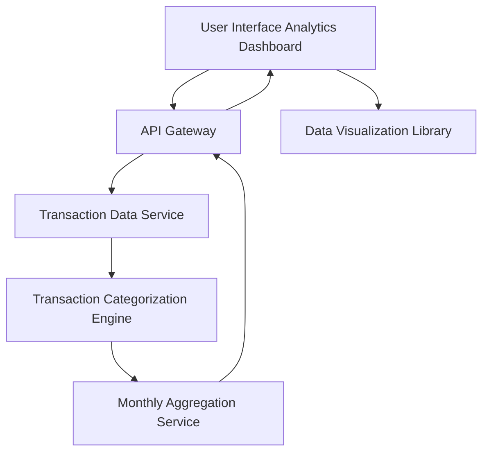

#### 1. High-Level Design

- **Summary**: This epic provides users with detailed spending analytics through interactive visualizations and category-wise spending breakdowns. Users can analyze spending patterns across nine predefined categories (Food & Dining, Fuel, Shopping, Travel, Entertainment, Utilities, Healthcare, Education, Miscellaneous), view monthly spend trends, and leverage interactive charts for drill-down analysis to identify spending patterns and optimization opportunities.

- **Component Flow**:

- **Integration Points**:
  - **Upstream Systems**: Transaction data service (provides raw transaction data for all credit cards), Transaction categorization engine (classifies transactions into predefined categories)
  - **Downstream Systems**: Monthly aggregation service (aggregates categorized transaction data by month and category), Data visualization library (renders interactive charts and graphs on the client side)

- **Key Assumptions**: 
  - Transactions are automatically categorized by the categorization engine using predefined rules; manual recategorization is out of scope
  - Monthly aggregation is performed on a calendar month basis; historical data is available for at least the current month

- **NFR Highlights**: Analytics visualizations must render within 3 seconds; support interactive filtering and drill-down capabilities; handle minimum 1000 transactions per user efficiently; charts must be responsive across devices

- **Data Flow**: User accesses the analytics dashboard, which requests transaction data via the API Gateway from the Transaction Data Service. The Transaction Categorization Engine processes raw transactions and assigns them to one of nine predefined categories. The Monthly Aggregation Service then aggregates categorized transactions by month and category, calculating spending totals and trends. The aggregated data is returned to the UI, where the Data Visualization Library renders interactive charts and graphs, enabling users to filter, drill down, and analyze spending patterns across categories and time periods.

#### 2. Validation Report

- **Requirements Coverage**: The design comprehensively covers the epic's scope including Category-wise spending visualization, Monthly spend trends analysis, Interactive charts and graphs, Spending breakdown by all nine categories, Transaction categorization, and Spending pattern identification. All NFRs are addressed: 3-second rendering time through efficient aggregation, interactive filtering via the visualization library, handling 1000+ transactions through the monthly aggregation service, and responsive charts across devices. Dependencies on transaction data service, transaction categorization engine, data visualization library, and monthly aggregation service are all integrated into the architecture.