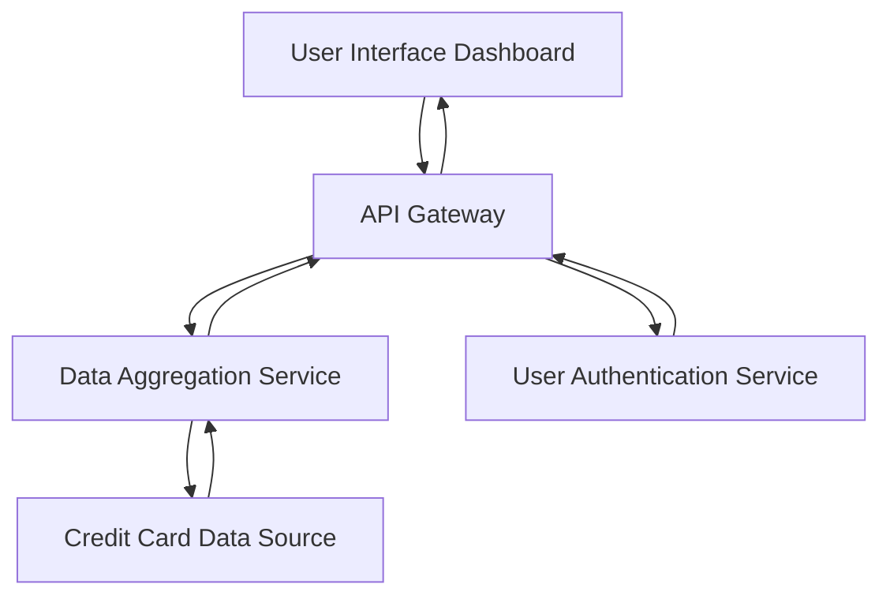

#### 1. High-Level Design

- **Summary**: This epic delivers a comprehensive financial overview dashboard displaying key performance indicators for credit card management. The dashboard provides real-time visibility into monthly spend, total credit limit, available credit, and outstanding amounts across all credit cards in a consolidated view, enabling users to monitor their financial health and make informed credit utilization decisions.

- **Component Flow**:

- **Integration Points**:
  - **Upstream Systems**: Credit card data source system (provides raw credit card transaction and account data), User authentication service (validates user identity and permissions)
  - **Downstream Systems**: Data aggregation service (consumes credit card data to calculate consolidated metrics such as total credit limit, available credit, outstanding amounts)

- **Key Assumptions**: 
  - Credit card data is available in real-time or near real-time (within seconds) from the data source system
  - Monthly spend is calculated based on the current calendar month; data aggregation service owns the calculation logic for all KPIs

- **NFR Highlights**: Dashboard must load within 2 seconds; support responsive design for mobile and desktop devices; real-time data refresh capability; support concurrent viewing by multiple users

- **Data Flow**: User accesses the dashboard via the UI, which authenticates the user through the authentication service. Upon successful authentication, the API Gateway requests consolidated financial metrics from the Data Aggregation Service. The aggregation service retrieves raw credit card data from the Credit Card Data Source, calculates KPIs (monthly spend, total credit limit, available credit, outstanding amount), and returns the processed metrics to the API Gateway. The dashboard UI then renders these KPIs in a responsive layout with real-time refresh capability.

#### 2. Validation Report

- **Requirements Coverage**: The design fully covers the epic's stated scope including Monthly Spend KPI display, Total Credit Limit calculation and display, Available Credit calculation and display, Outstanding Amount tracking, Consolidated financial metrics view, and Responsive dashboard layout. All NFRs related to performance (2-second load time), responsive design, real-time refresh, and concurrent user support are addressed through the architecture. Dependencies on credit card data source, user authentication service, and data aggregation service are explicitly integrated into the component flow.