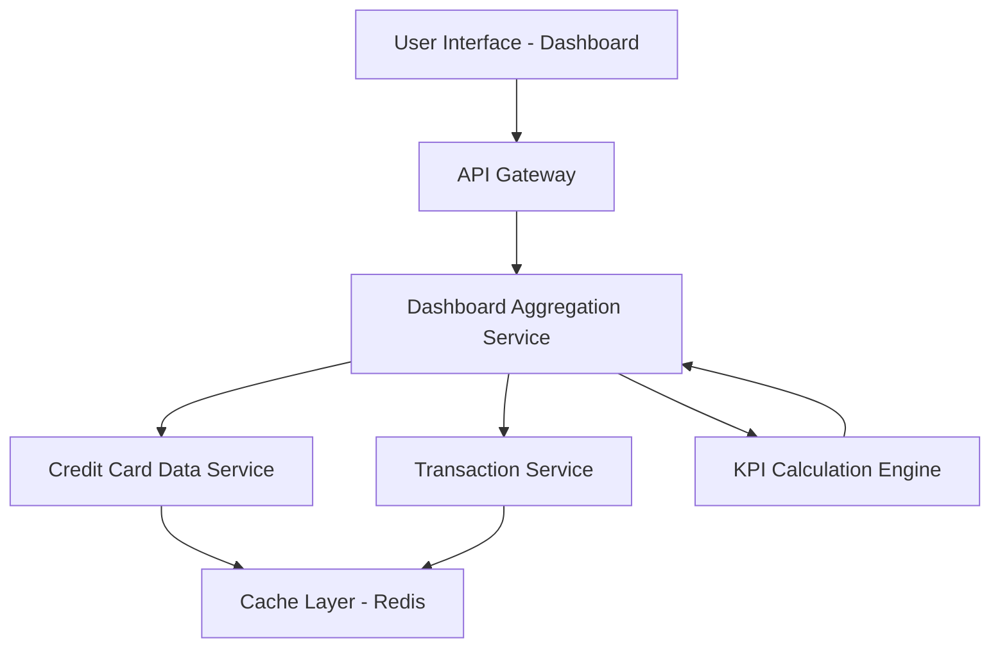

#### 1. High-Level Design

- **Summary:** This epic delivers a consolidated dashboard that displays key performance indicators (KPIs) for the user's entire credit card portfolio. The dashboard provides real-time visibility into critical financial metrics including monthly spend, total credit limit, available credit, and outstanding amounts across all credit cards. The solution features a modern, responsive design supporting desktop, tablet, and mobile devices, with page load times under 2 seconds and real-time data refresh capabilities.

- **Component Flow:**

- **Integration Points:**
  - **Upstream:** Credit Card Data Service (retrieves card balances, credit limits, and outstanding amounts)
  - **Upstream:** Transaction Service (calculates monthly spend and provides transaction summaries)
  - **Internal Component:** KPI Calculation Engine (aggregates data across multiple cards to compute portfolio-level KPIs)
  - **Infrastructure:** Cache Layer (Redis or similar) to support real-time refresh and sub-2-second page load requirements

- **Key Assumptions:**
  - "Real-time data refresh" means near-real-time (e.g., 5-15 minute cache refresh intervals) rather than true real-time streaming; actual refresh frequency to be defined based on backend system capabilities.
  - Monthly spend is calculated as the sum of all transactions in the current calendar month; calculation logic and timezone handling to be confirmed during implementation.

- **NFR Highlights:** Dashboard must be responsive across desktop, tablet, and mobile devices; Page load time must be under 2 seconds; Support real-time data refresh for KPI updates.

- **Data Flow:** User accesses Dashboard → API Gateway authenticates and routes request → Dashboard Aggregation Service checks Cache Layer for recent KPI data → If cache miss or stale, service queries Credit Card Data Service for all user cards' balances, limits, and outstanding amounts → Service queries Transaction Service for current month's transactions → KPI Calculation Engine computes portfolio-level metrics (total credit limit = sum of all card limits, available credit = sum of available credit across cards, total monthly spend = sum of current month transactions, total outstanding = sum of outstanding balances) → Aggregated KPIs are cached and returned to UI → Dashboard renders KPIs in responsive layout with visual indicators (utilization percentage, spending trends) → Real-time refresh mechanism periodically updates cache to reflect latest data.

#### 2. Validation Report

- **Requirements Coverage:** The design fully addresses the epic's scope including monthly spend display, total credit limit aggregation, available credit calculation, outstanding amount tracking, responsive dashboard layout, and multi-card consolidated view. All NFRs (responsive design across devices, sub-2-second load time, real-time refresh) are supported through caching strategies, efficient aggregation, and responsive UI frameworks. Integration dependencies with Credit Card Data Service and Transaction Service are clearly mapped. The inclusion of a KPI Calculation Engine and Cache Layer ensures performance requirements are met. Out-of-scope items (real bank integration, payments, fund transfers, loans) are excluded. The design should validate the definition of "real-time refresh" and monthly spend calculation logic during implementation planning to ensure alignment with business expectations.