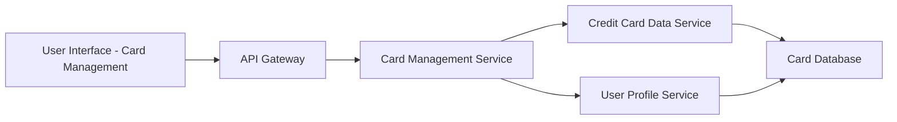

#### 1. High-Level Design

- **Summary:** This epic enables users to manage and view multiple credit cards (minimum 10 per user) within a unified interface. Users can view all registered cards with individual details, perform card-wise spend analysis, switch between cards, and identify cards using visual elements (masked card numbers, card brand logos). The solution consolidates multi-card management, eliminating the need for users to access multiple portals or applications for different credit cards.

- **Component Flow:**

- **Integration Points:**
  - **Upstream:** User Profile Service (validates card ownership and user authentication)
  - **Upstream:** Credit Card Data Service (retrieves card details, metadata, balances, and limits)
  - **Data Source:** Card Database (stores user-card mappings, card details, and security information)

- **Key Assumptions:**
  - Credit cards are already registered/linked to the user account through a separate onboarding process; this epic does not include adding new cards from external banks.
  - Card-wise spend analysis retrieves aggregated data from the Transaction Service (not explicitly mentioned but implied for spend analysis functionality).

- **NFR Highlights:** System must support minimum 10 credit cards per user; Card listing must load within 1 second; Secure storage and display of card information with masked card numbers (PCI-DSS compliance implied).

- **Data Flow:** User accesses Card Management interface → API Gateway authenticates request → Card Management Service queries User Profile Service to validate user identity and retrieve associated card IDs → Card Management Service calls Credit Card Data Service to fetch card details (card number masked, brand, type, expiry, limits, balances) for all user cards → Credit Card Data Service retrieves data from Card Database → Card Management Service returns consolidated card list to UI → User selects a specific card → UI displays detailed card information and card-wise spend analysis (retrieved from Transaction Service) → User can switch between cards seamlessly with fast load times (<1 second).

#### 2. Validation Report

- **Requirements Coverage:** The design comprehensively addresses the epic's scope including multiple credit card display, card-wise spend analysis, individual card details view, card selection and switching, and card identification with visual elements. All NFRs (10+ cards per user, 1-second load time, secure masked display) are supported through efficient service architecture, caching, and security controls. Integration dependencies with User Profile Service and Credit Card Data Service are clearly defined. Out-of-scope items (real bank integration, payments, adding external cards) are excluded, maintaining focused scope. The design assumes card-wise spend analysis requires integration with Transaction Service, which should be validated during implementation planning.