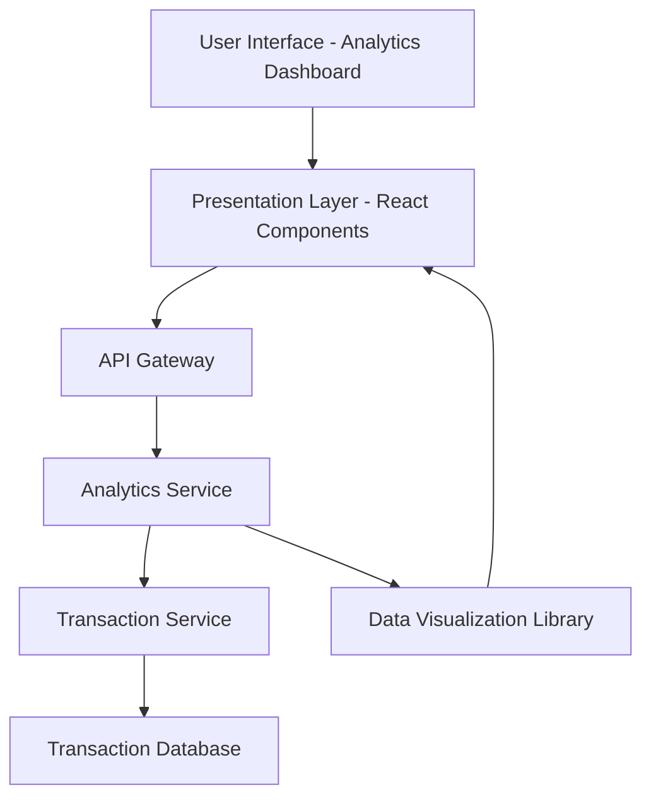

#### 1. High-Level Design

- **Summary:** This epic delivers a comprehensive spending analytics module that enables users to visualize and analyze their credit card spending patterns across nine predefined categories (Food & Dining, Fuel, Shopping, Travel, Entertainment, Utilities, Healthcare, Education, Miscellaneous). The solution provides interactive charts, monthly trend analysis, and historical spending data for up to 12 months, empowering users to make informed financial decisions and identify spending optimization opportunities.

- **Component Flow:**

- **Integration Points:**
  - **Upstream:** Transaction Service (retrieves categorized transaction data)
  - **Upstream:** Analytics Engine (generates spending insights and trends)
  - **External Library:** Data Visualization Library (renders interactive charts and graphs)
  - **Data Source:** Transaction Database (stores historical transaction records with category metadata)

- **Key Assumptions:**
  - Transactions are pre-categorized by the Transaction Service using rule-based or ML-based classification; the Analytics Service does not perform real-time categorization.
  - Monthly spend trends are calculated on-demand when the user accesses the analytics dashboard; no pre-computed aggregations are assumed unless specified by backend architecture.

- **NFR Highlights:** Analytics must support minimum 12 months of historical data; Visualization rendering must complete within 3 seconds; Category classification accuracy must be maintained for all transactions; Responsive design for desktop, tablet, and mobile.

- **Data Flow:** User accesses the Analytics Dashboard → Presentation Layer sends request to API Gateway → API Gateway routes to Analytics Service → Analytics Service queries Transaction Service for categorized transaction data from the past 12 months → Transaction Service retrieves data from Transaction Database → Analytics Service processes data to compute category-wise totals and monthly trends → Analytics Service returns aggregated data to Presentation Layer → Data Visualization Library renders interactive charts (pie charts for category breakdown, line/bar charts for monthly trends) → User interacts with visualizations to explore spending patterns.

#### 2. Validation Report

- **Requirements Coverage:** The design fully covers the epic's stated scope including category-wise spending visualization, monthly spend trends, interactive charts, nine spending categories tracking, transaction categorization, and historical spending analysis. All NFRs (12 months historical data, 3-second rendering, category accuracy) are addressed through appropriate service architecture and caching strategies. Integration dependencies with Transaction Service, Analytics Engine, and Data Visualization Library are clearly mapped. Out-of-scope items (real bank integration, payments, predictive forecasts, budget alerts) are explicitly excluded, ensuring focused delivery.