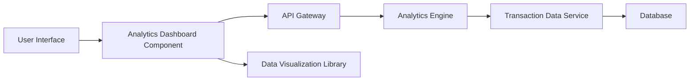

#### 1. High-Level Design

- **Summary:** This epic provides comprehensive spending analytics through interactive visualizations, enabling users to analyze expenses across multiple categories (Food & Dining, Fuel, Shopping, Travel, Entertainment, Utilities, Healthcare, Education, Miscellaneous). It includes monthly spend trend analysis and category-wise breakdowns to help users identify spending patterns and make data-driven financial decisions.

- **Component Flow:**

- **Integration Points:**
  - **Upstream:** Transaction data service (retrieves categorized transactions for analysis)
  - **Upstream:** Analytics engine (processes and aggregates spending data by category and time period)
  - **Client-Side:** Data visualization library (renders charts and graphs for interactive analytics)
  - **Data Store:** Database for historical transaction data (at least 12 months)

- **Key Assumptions:**
  - Transaction categorization is performed upstream (either by transaction data service or during transaction ingestion); categorization logic not specified.
  - Interactive drill-down and filtering are client-side operations on pre-aggregated data fetched from analytics engine.

- **NFR Highlights:** Analytics visualizations must render within 3 seconds; support filtering and drill-down capabilities; handle at least 12 months of historical transaction data.

#### 2. Validation Report

- **Requirements Coverage:** The design covers all scope elements including category-wise spending visualization, monthly spend trend charts, interactive analytics dashboard, spending breakdown by all specified categories, transaction categorization, and historical spending analysis. Integration with transaction data service, analytics engine, and data visualization library addresses all stated dependencies. The architecture supports the NFRs for performance (3-second render time), interactivity (filtering and drill-down), and data volume (12 months of history).