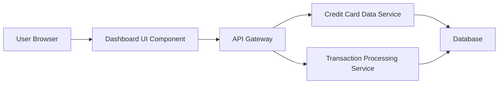

#### 1. High-Level Design

- **Summary:** This epic delivers a centralized, responsive dashboard that displays key performance indicators (KPIs) for a user's credit card portfolio, including monthly spend, total credit limit, available credit, and outstanding amounts. The dashboard provides real-time visibility into financial health and credit utilization across all cards in a single interface.

- **Component Flow:**

- **Integration Points:**
  - **Upstream:** Credit card data service (retrieves card details, balances, and credit limits)
  - **Upstream:** Transaction processing service (calculates monthly spend and outstanding amounts)
  - **Data Store:** Database for persistent storage of card and transaction data

- **Key Assumptions:**
  - Real-time data refresh implies polling or event-driven updates from backend services; frequency not specified (assumed every 30-60 seconds).
  - KPI calculations (available credit, outstanding amounts) are performed server-side and delivered via API.

- **NFR Highlights:** Dashboard must be responsive across desktop, tablet, and mobile devices; page load time under 2 seconds; support real-time data refresh for KPIs.

#### 2. Validation Report

- **Requirements Coverage:** The design covers all stated scope elements including dashboard interface, KPI displays (monthly spend, credit limit, available credit, outstanding amount), responsive layout, and multi-card consolidated view. Integration with credit card data service and transaction processing service addresses the dependencies. The architecture supports the NFRs for responsiveness, performance (2-second load time), and real-time refresh capabilities.