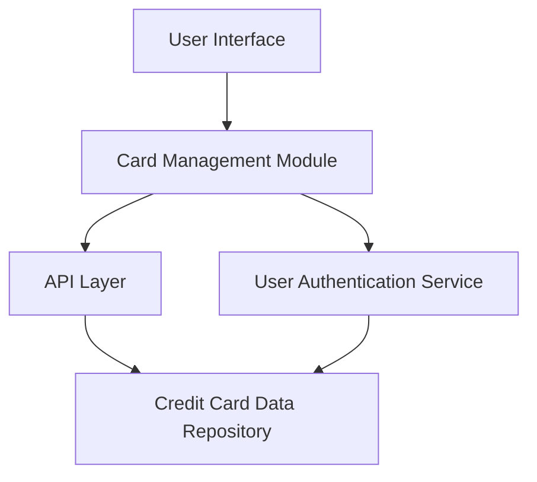

#### 1. High-Level Design

- **Summary:** This epic enables users to manage and monitor multiple credit cards within a single interface, providing visibility into all cards with relevant details such as credit limits, balances, and card status. Users can switch between cards and access card-specific information without navigating to different platforms.

- **Component Flow:**

- **Integration Points:**
  - **Upstream:** Credit card data repository (stores and retrieves card information for all user cards)
  - **Upstream:** User authentication service (ensures secure access to card data)
  - **Data Store:** Credit card data repository for persistent card details

- **Key Assumptions:**
  - Card switching functionality assumes client-side state management with server-side data fetching per card selection.
  - Card status indicators (active, inactive, blocked) are maintained in the credit card data repository and retrieved via API.

- **NFR Highlights:** System must support display of at least 10 credit cards per user; card switching response time under 500ms; data consistency across all card views.

#### 2. Validation Report

- **Requirements Coverage:** The design addresses all scope elements including multi-card display interface, card details view, card selection and switching functionality, card-wise spend analysis, individual card tracking, and card status indicators. Integration with credit card data repository and user authentication service satisfies the stated dependencies. The architecture supports the NFRs for scalability (10+ cards), performance (500ms switching), and data consistency.