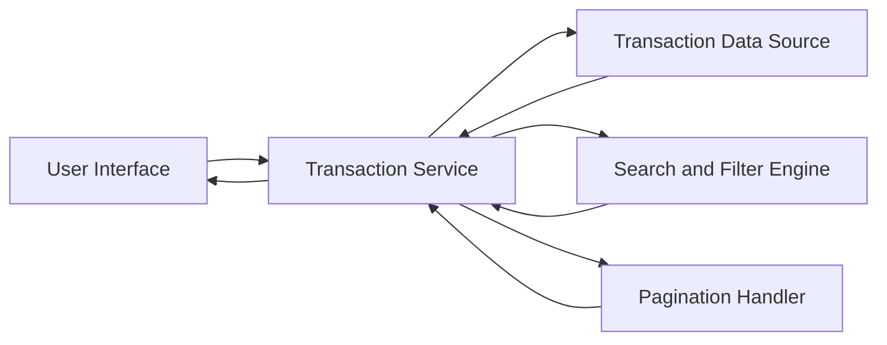

### 1. High-Level Design

**Summary:**  
This epic enables users to view and monitor credit card transactions across all their cards in a centralized interface. Users can access transaction history, review spending details, search, and filter transactions, providing complete visibility into credit usage for financial awareness and fraud detection.

**Component Flow:**

**Integration Points:**
- **Upstream:** Transaction data service or mock transaction data source (provides transaction records with details such as date, merchant, amount, category, card ID)
- **Lateral:** Credit card data (for card-specific transaction filtering and multi-card support)

**Key Assumptions:**
- Transaction data includes standard fields: transaction ID, date, merchant name, amount, card identifier, and optionally category.
- Pagination is required for handling large transaction volumes; default page size and sorting order will be defined during implementation.

**NFR Highlights:**  
System must handle transaction data for multiple credit cards efficiently; Transaction list must load within 3 seconds; Support pagination for large transaction volumes.

### 2. Validation Report

**Requirements Coverage:**  
The design covers all stated requirements including transaction history view, multi-card tracking, transaction details display, and search/filtering capabilities. The component flow addresses data retrieval, filtering, pagination, and presentation. Integration with transaction data source and credit card data ensures multi-card support. NFRs for 3-second load time and efficient handling of large data volumes are incorporated into the design.