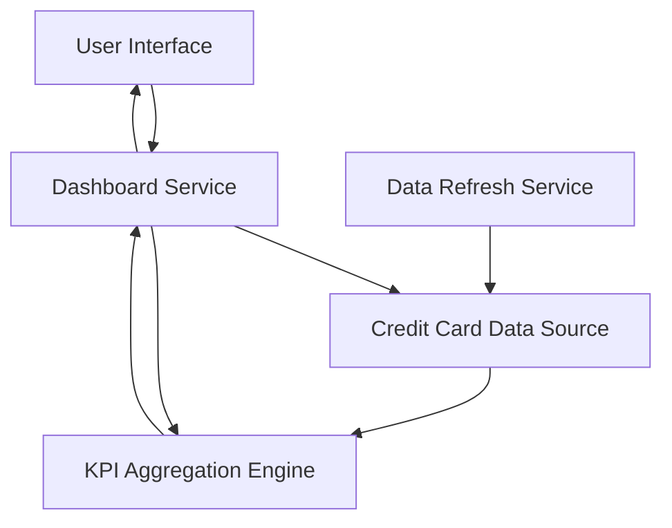

### 1. High-Level Design

**Summary:**  
This epic provides a consolidated dashboard interface displaying key performance indicators (KPIs) for all user credit cards. Users can view monthly spend, total credit limit, available credit, and outstanding amounts in a unified view, enabling better credit utilization tracking and financial decision-making.

**Component Flow:**

**Integration Points:**
- **Upstream:** Credit card data source or mock data service (provides card information, balances, limits, and outstanding amounts)
- **Downstream:** Provides aggregated KPI data to other modules (e.g., Analytics module for consistent presentation)

**Key Assumptions:**
- Credit card data is available via API or mock service with fields for card number, limit, balance, outstanding amount, and monthly spend.
- Real-time or near-real-time data refresh is supported by the upstream data source with acceptable latency.

**NFR Highlights:**  
System must support responsive layouts across desktop, tablet, and mobile devices; Dashboard load time must be under 2 seconds; Support for real-time data refresh.

### 2. Validation Report

**Requirements Coverage:**  
The design addresses all core requirements including KPI display, monthly spend tracking, credit limit aggregation, available credit calculation, outstanding amount tracking, and multi-card portfolio view. The component flow ensures data retrieval, aggregation, and presentation with real-time refresh capability. NFRs for responsiveness and 2-second load time are incorporated into the design considerations.