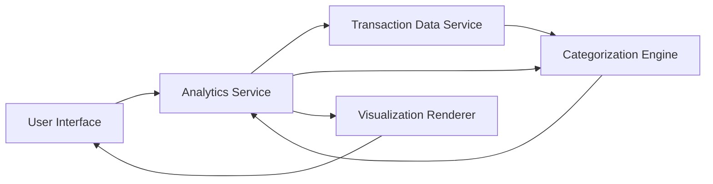

### 1. High-Level Design

**Summary:**  
This epic delivers an interactive analytics module that visualizes user spending patterns across 9 predefined categories (Food & Dining, Fuel, Shopping, Travel, Entertainment, Utilities, Healthcare, Education, Miscellaneous). It provides monthly trend analysis and card-wise spending breakdowns to enable data-driven financial decisions.

**Component Flow:**

**Integration Points:**
- **Upstream:** Transaction data service (provides raw transaction data for analysis)
- **Upstream:** Categorization engine or pre-categorized transaction data source
- **Lateral:** Dashboard KPIs (for consistent data presentation across modules)

**Key Assumptions:**
- Transaction data is pre-categorized or a categorization engine assigns categories automatically based on merchant codes or transaction descriptions.
- Historical data for up to 12 months is available and accessible with acceptable query performance.

**NFR Highlights:**  
Visualizations must render within 2 seconds; Charts must be interactive and responsive across all device types; System must support data aggregation for up to 12 months of historical spending data.

### 2. Validation Report

**Requirements Coverage:**  
The design covers all stated requirements including category-wise visualization, monthly trends, card-wise analysis, and interactive charting. The component flow addresses data retrieval, categorization, aggregation, and rendering. Integration with transaction data service and dashboard KPIs ensures consistency. NFRs for performance (2-second render time) and responsiveness are acknowledged and will guide implementation.