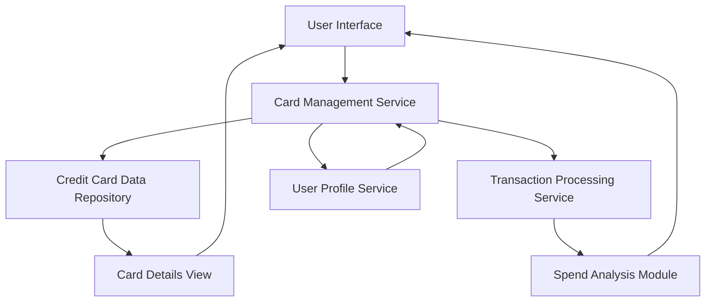

#### 1. High-Level Design

- **Summary**: This epic enables users to manage and monitor multiple credit cards from a unified interface. The system displays all user credit cards with individual card details, card-specific spending analysis, credit limits, available credit, and outstanding balances. Users can track individual card performance and monthly spend trends for each card in their portfolio.

- **Component Flow**:

- **Integration Points**:
  - **Upstream**: Credit card data repository for storing and retrieving card information (card numbers, limits, balances)
  - **Upstream**: Transaction processing service for card-wise spend calculations and aggregations
  - **Upstream**: User profile service for card ownership validation and user-card association management
  - **Data Source**: Centralized repository containing multi-card data and transaction history

- **Key Assumptions**: 
  - Card ownership is validated at the user profile level; card linking/unlinking workflow is handled separately or assumed pre-configured.
  - Card-wise spend analysis aggregates transactions by card ID; transaction attribution to specific cards is accurate and maintained in the transaction data.

- **NFR Highlights**: System must support minimum 10 credit cards per user account, card data synchronization must occur within 5 seconds, maintain data consistency across all card views.

- **Data Flow**: User accesses card management interface → Card Management Service validates user ownership via User Profile Service → Service retrieves all associated cards from Credit Card Data Repository → Transaction Processing Service calculates card-wise spending, trends, and balances → Card Details View and Spend Analysis Module render individual card information → User views consolidated multi-card portfolio with card-specific metrics, spending patterns, and monthly trends.

#### 2. Validation Report

- **Requirements Coverage**: The design fully addresses all epic requirements including multiple credit card display, card-wise spend analysis, individual card details view, card-specific credit limit tracking, card-specific outstanding balance display, and monthly spend trends per card. All NFRs are covered: minimum 10 cards per user through scalable data model, 5-second synchronization through optimized data access patterns, and data consistency through transactional data operations. All integration dependencies (credit card data repository, transaction processing service, user profile service) are properly identified and incorporated into the architecture.