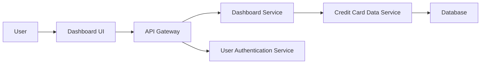

#### 1. High-Level Design

- **Summary**: This epic provides a consolidated dashboard that displays critical financial metrics across all user credit cards. The dashboard aggregates and presents real-time KPIs including monthly spending, total credit limits, available credit, and outstanding amounts through a responsive interface that adapts to desktop and mobile devices.

- **Component Flow**:

- **Integration Points**:
  - **Upstream**: Credit card data service for retrieving card balances, limits, and transaction data
  - **Upstream**: User authentication service for secure access control and user identity validation
  - **Data Source**: Centralized database containing credit card information, transaction history, and user profiles

- **Key Assumptions**: 
  - "Real-time" data refresh means near-real-time (within acceptable latency); actual bank data sync frequency is managed by the credit card data service.
  - KPI calculations (available credit, utilization %) follow standard formulas; business rules for credit limit aggregation are predefined.

- **NFR Highlights**: Dashboard must load within 2 seconds, support responsive design across desktop and mobile devices, handle real-time data refresh for up to 100 credit cards per user.

- **Data Flow**: User authenticates → Authentication Service validates credentials → Dashboard Service requests aggregated data → Credit Card Data Service retrieves card balances, limits, and transactions from Database → Dashboard Service calculates KPIs (monthly spend, total credit limit, available credit, outstanding amounts) → Dashboard UI renders consolidated metrics → User views real-time financial health across all cards.

#### 2. Validation Report

- **Requirements Coverage**: The design comprehensively covers all stated requirements including monthly spend display, total credit limit aggregation, available credit calculation, outstanding amount tracking, responsive dashboard layout, and multi-card KPI consolidation. All NFRs are addressed: 2-second load time through optimized API calls, responsive design through adaptive UI framework, and support for up to 100 cards through scalable service architecture. Integration dependencies with credit card data service and user authentication service are clearly defined and mapped.