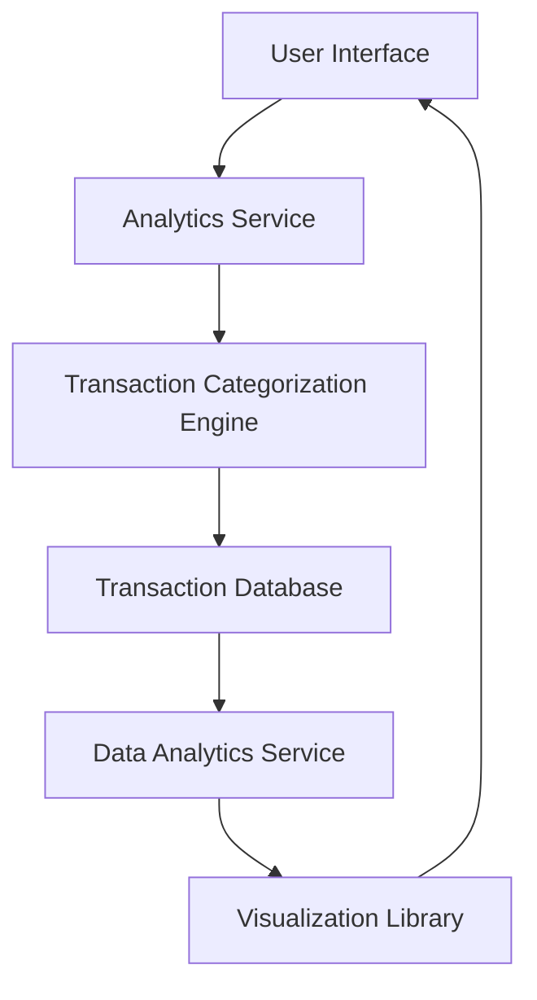

#### 1. High-Level Design

- **Summary**: This epic delivers a comprehensive analytics and visualization module that enables users to understand their spending patterns across nine predefined categories (Food & Dining, Fuel, Shopping, Travel, Entertainment, Utilities, Healthcare, Education, Miscellaneous). The system processes transaction data, categorizes expenses, and presents insights through interactive charts and graphs with monthly trend analysis capabilities.

- **Component Flow**:

- **Integration Points**:
  - **Upstream**: Transaction categorization engine for automatic expense classification
  - **Upstream**: Data analytics service for trend calculations and pattern analysis
  - **Downstream**: Visualization library (e.g., Chart.js, D3.js, or similar) for rendering interactive charts and graphs
  - **Data Source**: Transaction database containing user transaction history

- **Key Assumptions**: 
  - Transactions are pre-classified or auto-categorized using predefined rules/ML models; manual category override capability may be needed but not specified.
  - Monthly aggregation is based on transaction date; timezone and currency conversion logic is handled upstream.

- **NFR Highlights**: Visualization rendering must complete within 3 seconds, support interactive filtering and drill-down, handle up to 10,000 transactions per user, charts must be responsive and mobile-friendly.

- **Data Flow**: User requests spending analytics → Analytics Service retrieves transaction data → Transaction Categorization Engine classifies expenses into 9 categories → Data Analytics Service aggregates and calculates monthly trends → Visualization Library renders interactive charts → User views category breakdowns, trends, and patterns with drill-down capabilities.

#### 2. Validation Report

- **Requirements Coverage**: The design fully covers the epic's stated scope including category-wise spending breakdown across 9 categories, interactive visualizations, monthly spend trend charts, spending pattern analysis, graphical representation, and trend comparison. All NFRs (3-second rendering, interactive filtering, 10K transaction handling, responsive design) are addressed through appropriate architectural components. Integration dependencies with categorization engine, analytics service, and visualization library are clearly mapped.