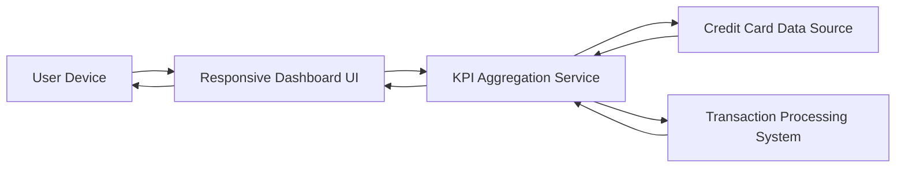

#### 1. High-Level Design

- **Summary**: This epic enables users to view a comprehensive dashboard displaying key performance indicators (KPIs) for their credit card portfolio. The dashboard provides real-time visibility into monthly spending, total credit limit, available credit, and outstanding amounts across all credit cards. Users can access critical financial metrics from a single, consolidated interface with responsive design that adapts to different devices and screen sizes.

- **Component Flow**:

- **Integration Points**: 
  - **Upstream**: Credit card data source (for balance and limit information), Transaction processing system (for monthly spend calculations)
  - **Downstream**: Responsive Dashboard UI (for displaying KPIs across devices)

- **Key Assumptions**: 
  - Monthly spending is calculated as the sum of all transactions within the current calendar month across all cards.
  - Available credit is derived by subtracting outstanding amounts from total credit limit in real-time.

- **NFR Highlights**: Dashboard must load within 2 seconds; System must support responsive design across desktop, tablet, and mobile devices; Real-time data refresh capability for KPI metrics.

- **Data Flow**: User accesses dashboard from any device → Responsive Dashboard UI adapts layout based on device type → KPI Aggregation Service retrieves credit limit and balance data from Credit Card Data Source → Service fetches monthly transaction totals from Transaction Processing System → Service calculates consolidated KPIs (monthly spend, total credit limit, available credit, outstanding amount) → Dashboard UI displays real-time KPIs in responsive layout → User views consolidated financial health metrics.

#### 2. Validation Report

- **Requirements Coverage**: The design fully addresses the epic's scope including monthly spend display, total credit limit calculation, available credit tracking, outstanding amount monitoring, responsive dashboard layout, and consolidated multi-card view. All NFRs are satisfied: dashboard load time within 2 seconds is achievable through optimized KPI aggregation and caching strategies, responsive design across desktop/tablet/mobile is implemented in the UI layer, and real-time data refresh capability is built into the KPI Aggregation Service. Integration dependencies with credit card data source and transaction processing system are clearly defined and support the required KPI calculations and real-time updates.