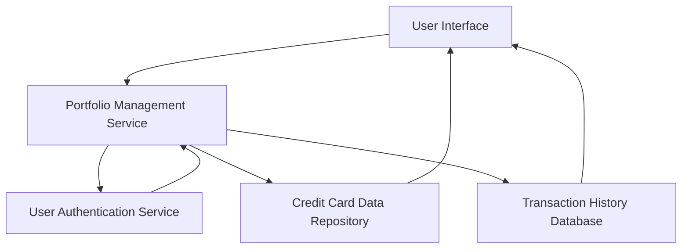

#### 1. High-Level Design

- **Summary**: This epic allows users to manage and monitor multiple credit cards within a single interface. Users can view all their credit cards with individual card details, track card-specific spending patterns, and analyze performance across their entire credit card portfolio. The feature provides card-wise spend analysis enabling users to understand which cards are being utilized most effectively and identify opportunities for optimization.

- **Component Flow**:

- **Integration Points**: 
  - **Upstream**: Credit card data repository (for card details, limits, and balances), User authentication service (for secure card access), Transaction history database (for card-wise spending data)
  - **Downstream**: User Interface (for displaying card portfolio and spend analysis)

- **Key Assumptions**: 
  - Card numbers are masked by default for security, displaying only the last 4 digits.
  - Monthly spend trends per card are calculated by aggregating transactions grouped by card ID and month.

- **NFR Highlights**: System must support minimum 10 credit cards per user; Card data retrieval must complete within 1 second; Secure storage and display of card information with masked card numbers.

- **Data Flow**: User logs in and is authenticated via User Authentication Service → Portfolio Management Service retrieves card details from Credit Card Data Repository → Service fetches card-specific transaction data from Transaction History Database → System aggregates spending by card and time period → User Interface displays all cards with individual details, spend analysis, and portfolio overview → User views and analyzes card-wise performance.

#### 2. Validation Report

- **Requirements Coverage**: The design comprehensively covers the epic's scope including multiple credit card display, card-wise spend analysis, individual card details view, card portfolio overview, and monthly spend trends per card. All NFRs are addressed: support for minimum 10 cards per user is built into the data model, card data retrieval within 1 second is achievable through optimized queries, and secure storage with masked card numbers is enforced through the authentication and display layers. Integration dependencies with credit card data repository, user authentication service, and transaction history database are properly mapped and support the required functionality.