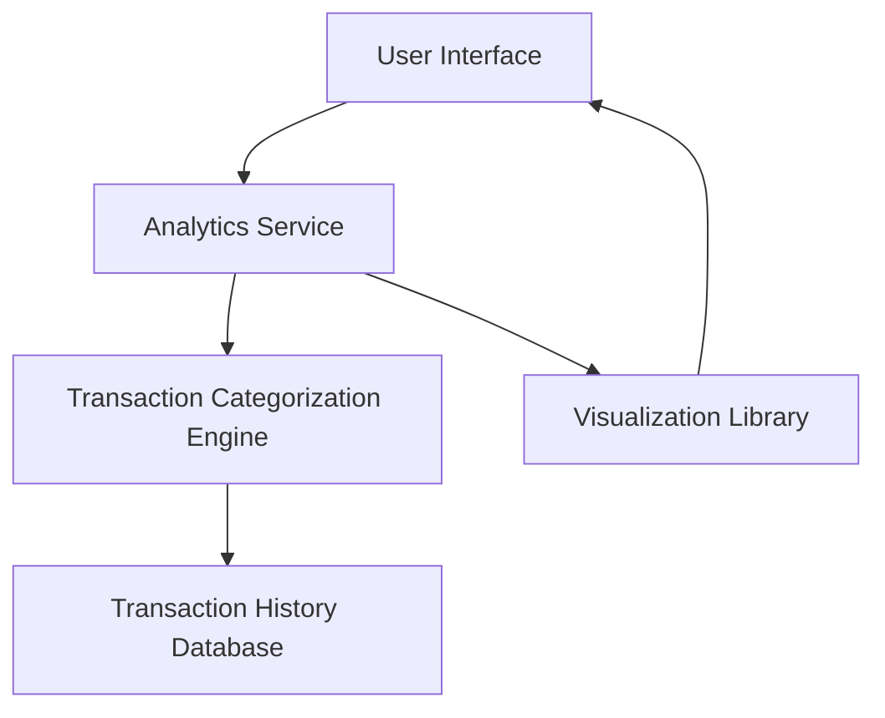

#### 1. High-Level Design

- **Summary**: This epic delivers interactive visualizations and analytics capabilities that help users understand their spending patterns across different categories. The system provides category-wise spending analysis covering Food & Dining, Fuel, Shopping, Travel, Entertainment, Utilities, Healthcare, Education, and Miscellaneous categories. Users can explore monthly spend trends through visual charts and graphs, identify spending patterns, and gain actionable insights into their financial behavior.

- **Component Flow**:

- **Integration Points**: 
  - **Upstream**: Transaction categorization engine (for category assignment), Transaction history database (for historical transaction data)
  - **Downstream**: Visualization library (for rendering charts and graphs), Data analytics service (for trend analysis and pattern identification)

- **Key Assumptions**: 
  - Transactions are pre-categorized by the transaction categorization engine before being stored in the database.
  - Monthly spend trends are calculated based on transaction timestamps and aggregated at the category level.

- **NFR Highlights**: Analytics queries must execute within 3 seconds; System must handle historical data for minimum 12 months; Visualizations must render smoothly with up to 1000 transactions per month.

- **Data Flow**: User requests spending analytics through the UI → Analytics Service retrieves transaction data from Transaction History Database → Transaction Categorization Engine ensures proper category assignment → Analytics Service aggregates data by category and time period → Visualization Library renders interactive charts and graphs → User views spending insights and trends on the UI.

#### 2. Validation Report

- **Requirements Coverage**: The design fully covers the epic's stated scope including category-wise spending visualization across nine categories, monthly spend trend analysis, interactive charts and graphs, spending pattern identification, and financial insights generation. All NFRs regarding query execution time (3 seconds), historical data retention (12 months), and transaction volume handling (1000 transactions/month) are addressed through the architecture. The integration points with transaction categorization engine, data analytics service, transaction history database, and visualization library are clearly defined and support the required functionality.