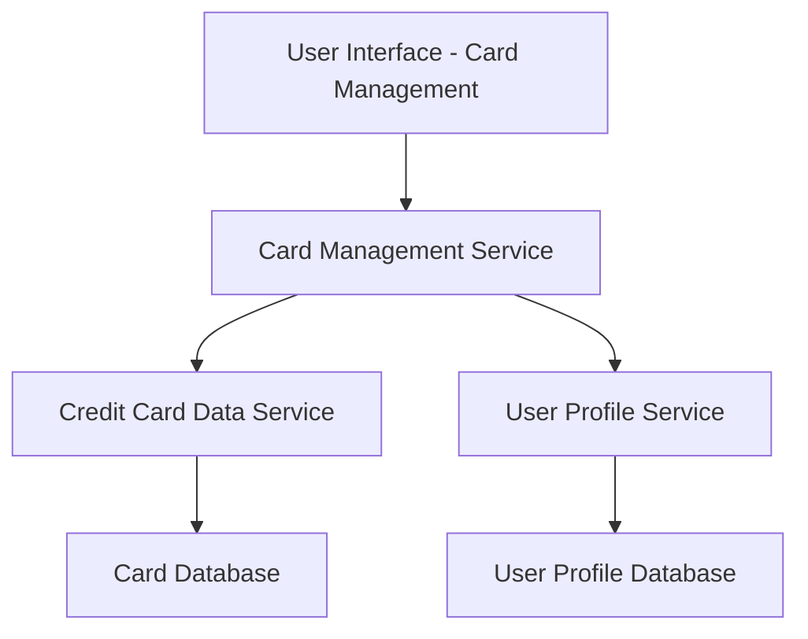

#### 1. High-Level Design

- **Summary:** This epic enables users to manage and view multiple credit cards within the dashboard interface. Users can view all registered credit cards with individual details, switch between cards, and access card-specific information including credit limits, balances, and metadata. The system supports at least 10 cards per user with seamless navigation.

- **Component Flow:**

- **Integration Points:**
  - **Upstream:** Credit Card Data Service (retrieves individual card information, balances, limits, metadata)
  - **Upstream:** User Profile Service (links credit cards to user accounts and manages card associations)

- **Key Assumptions:** 
  - Card metadata includes card type, issuer, last four digits, expiry date, and other non-sensitive identifiers.
  - Card switching is a client-side navigation event with backend data fetch, not requiring full page reload.

- **NFR Highlights:** System must support at least 10 credit cards per user; card switching response time must be under 500ms; data must be securely encrypted in transit and at rest.

- **Data Flow:** User accesses Card Management UI → Card Management Service retrieves list of user's cards from User Profile Service → For each card, Card Management Service fetches card details from Credit Card Data Service → Card Database provides card-specific data (limits, balances, metadata) → All card information is aggregated and sent to UI → User views multiple cards in consolidated view → User selects a specific card → Card Management Service fetches detailed card-specific information → Card details are displayed with spend analysis and metadata → All data transmission is encrypted per security NFRs.

#### 2. Validation Report

- **Requirements Coverage:** The design comprehensively covers all requirements including multiple credit card display, card-wise information view, card selection and navigation, individual card details, card-wise spend analysis, and card metadata management. The architecture supports the NFRs for handling at least 10 cards per user, sub-500ms card switching response time, and secure data encryption in transit and at rest. Integration dependencies with Credit Card Data Service and User Profile Service are properly addressed. The component flow ensures efficient card management and quick navigation between cards.