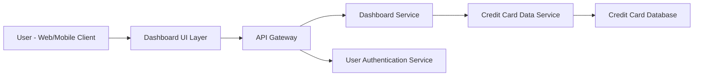

#### 1. High-Level Design

- **Summary:** This epic delivers a consolidated dashboard that displays key performance indicators (KPIs) for users' credit card portfolios. Users can monitor monthly spend, total credit limit, available credit, and outstanding amounts across all credit cards in a single, responsive interface with real-time data refresh capabilities.

- **Component Flow:**

- **Integration Points:**
  - **Upstream:** Credit Card Data Service (retrieves card balances, transaction data, credit limits)
  - **Upstream:** User Authentication Service (ensures secure access to dashboard)
  - **Internal:** API Gateway (routes requests and manages authentication)

- **Key Assumptions:** 
  - Credit Card Data Service provides aggregated KPI data or raw data that can be quickly computed for dashboard display.
  - Real-time data refresh is achieved through polling or push mechanisms with acceptable latency.

- **NFR Highlights:** Dashboard must be responsive across desktop, tablet, and mobile devices; page load time must be under 3 seconds; supports real-time data refresh for KPI metrics.

- **Data Flow:** User authenticates via User Authentication Service → User accesses Dashboard UI → Dashboard UI sends request through API Gateway to Dashboard Service → Dashboard Service queries Credit Card Data Service for KPI data (monthly spend, credit limits, available credit, outstanding amounts) → Credit Card Data Service retrieves data from Credit Card Database → Aggregated KPI data is returned to Dashboard Service → Dashboard Service formats and sends data to Dashboard UI → KPIs are displayed to user in responsive layout → Real-time refresh triggers periodic data fetch cycles.

#### 2. Validation Report

- **Requirements Coverage:** The design fully addresses all epic requirements including dashboard KPI display, monthly spend tracking, total credit limit aggregation, available credit calculation, outstanding amount visibility, responsive layout, and multi-card consolidated view. The architecture supports the NFRs for cross-device responsiveness, 3-second page load time, and real-time data refresh. Integration dependencies with Credit Card Data Service and User Authentication Service are properly incorporated. The component flow ensures secure, efficient data retrieval and presentation.