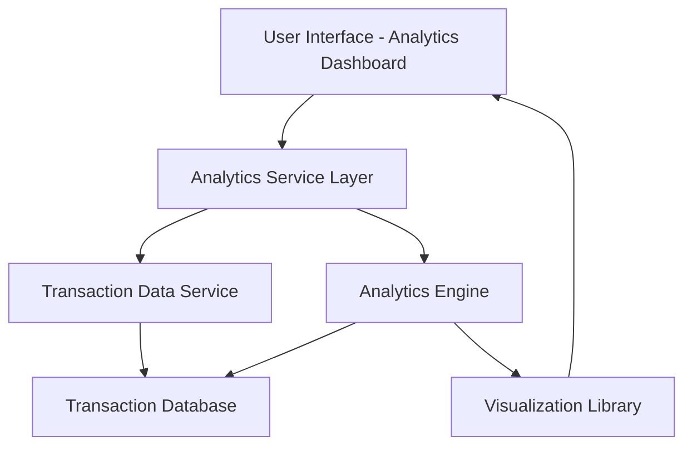

#### 1. High-Level Design

- **Summary:** This epic provides users with interactive analytics and visualization capabilities to understand spending patterns over time. It includes monthly spend trend analysis, category-wise spending breakdown across 9 predefined categories (Food & Dining, Fuel, Shopping, Travel, Entertainment, Utilities, Healthcare, Education, Miscellaneous), and drill-down capabilities for detailed financial behavior insights.

- **Component Flow:**

- **Integration Points:**
  - **Upstream:** Transaction Data Service (provides raw transaction data)
  - **Upstream:** Analytics Engine (processes and categorizes transactions)
  - **Internal:** Visualization Library (renders charts and interactive elements)

- **Key Assumptions:** 
  - Transactions are pre-categorized or the analytics engine has a rule-based categorization logic for the 9 predefined categories.
  - Historical transaction data is readily accessible and stored in a queryable format for at least 12 months.

- **NFR Highlights:** Visualizations must render within 2 seconds; filtering and drill-down operations must respond in sub-second times; system must handle at least 12 months of historical transaction data.

- **Data Flow:** User requests spending analytics from the UI → Analytics Service Layer fetches transaction data from Transaction Data Service → Analytics Engine processes and categorizes transactions by month and category → Processed data is formatted and sent to Visualization Library → Interactive charts and graphs are rendered on the Analytics Dashboard → User interacts with visualizations for drill-down analysis, triggering filtered data requests back through the same flow.

#### 2. Validation Report

- **Requirements Coverage:** The design comprehensively covers all stated requirements including monthly spend trends, category-wise analysis across 9 categories, interactive visualizations, spending pattern identification, transaction categorization, multi-dimensional views, and time-based comparisons. The architecture supports the NFRs for rendering performance (2 seconds), drill-down response times (sub-second), and 12-month historical data handling. All integration points with Transaction Data Service, Analytics Engine, and Visualization Library are addressed.