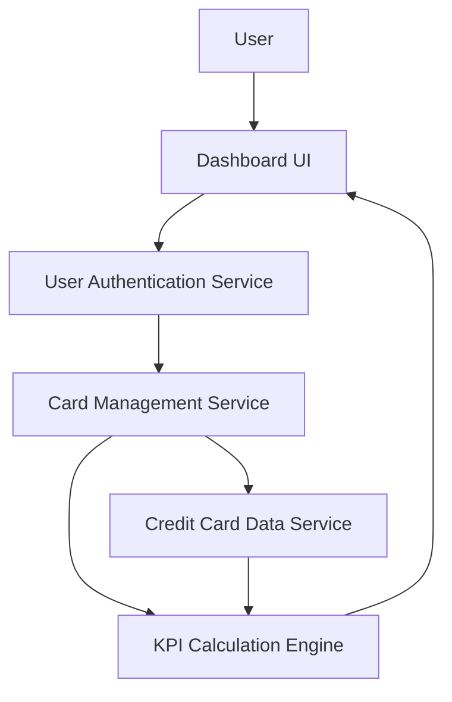

#### 1. High-Level Design

- **Summary:** This epic creates a unified dashboard interface that consolidates multiple credit cards and displays key performance indicators (KPIs) including monthly spend, total credit limit, available credit, and outstanding amounts. The system provides real-time visibility into credit card portfolio health, enabling users to monitor financial metrics and credit utilization across all cards from a single view.

- **Component Flow:**

- **Integration Points:**
  - **Upstream:** User Authentication Service (validates user identity and access permissions)
  - **Upstream:** Credit Card Data Service (retrieves card details, balances, limits, and transaction summaries)
  - **Internal:** KPI Calculation Engine (computes derived metrics such as available credit and credit utilization)

- **Key Assumptions:**
  - Credit Card Data Service provides real-time or near-real-time data with refresh intervals sufficient to meet the 2-second dashboard load requirement.
  - Available credit is calculated as (Total Credit Limit - Outstanding Amount) by the KPI Calculation Engine.

- **NFR Highlights:** System must provide responsive layouts across devices; dashboard must load within 2 seconds; support real-time data refresh of card balances and limits.

- **Data Flow:** User logs in → User Authentication Service validates credentials and establishes session → User navigates to dashboard → Dashboard UI requests card portfolio data from Card Management Service → Service retrieves card details from Credit Card Data Service (card numbers, limits, balances, outstanding amounts) → KPI Calculation Engine computes derived metrics (available credit, utilization percentage, monthly spend totals) → Consolidated KPI data is returned to Dashboard UI → Dashboard displays all cards with KPIs in a responsive layout → Real-time refresh mechanism periodically updates balances and limits without full page reload.

#### 2. Validation Report

- **Requirements Coverage:** The design fully addresses the epic's scope including dashboard KPI display, multiple credit card view, monthly spend tracking, total credit limit display, available credit calculation, outstanding amount tracking, and consolidated card interface. The architecture satisfies all NFRs: responsive layouts are achieved through adaptive UI components; 2-second load time is met through optimized data retrieval and KPI computation; real-time refresh is supported via polling or push mechanisms. The authentication layer ensures secure access, and the modular design allows for independent scaling of data services and calculation engines.