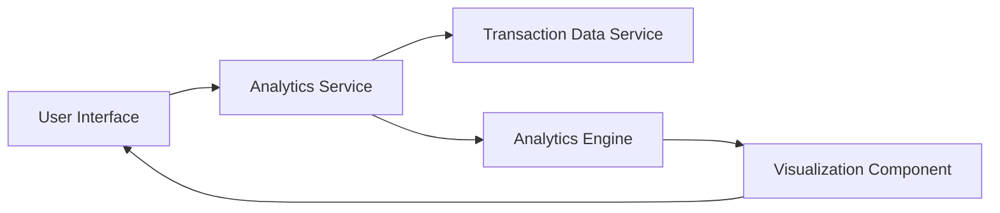

#### 1. High-Level Design

- **Summary:** This epic provides interactive analytics and visualization capabilities that enable users to understand spending patterns through category-wise analysis. The system processes transaction data across nine predefined categories (Food & Dining, Fuel, Shopping, Travel, Entertainment, Utilities, Healthcare, Education, Miscellaneous) and presents insights through interactive charts and graphs, supporting drill-down capabilities for detailed analysis.

- **Component Flow:**

- **Integration Points:**
  - **Upstream:** Transaction Data Service (provides categorized transaction data)
  - **Internal:** Analytics Engine (performs data aggregation, computation, and statistical analysis)
  - **Frontend:** Visualization Component (renders interactive charts and graphs)

- **Key Assumptions:**
  - Transactions are pre-categorized by the Transaction Data Service into one of the nine predefined categories, or a categorization algorithm is applied at ingestion time.
  - Interactive filtering and drill-down operations are client-side operations on pre-aggregated data to meet the 1-second rendering requirement.

- **NFR Highlights:** Visualizations must render within 1 second; support interactive filtering and drill-down capabilities; charts must be responsive and mobile-optimized.

- **Data Flow:** User accesses analytics dashboard → Analytics Service requests categorized transaction data from Transaction Data Service → Data is retrieved and passed to Analytics Engine → Engine aggregates spending by category, card, and time period → Aggregated data is formatted for visualization → Visualization Component renders interactive charts (pie charts, bar graphs, trend lines) → User interacts with charts to filter by category, card, or time range → UI updates dynamically with filtered results.

#### 2. Validation Report

- **Requirements Coverage:** The design comprehensively addresses the epic's scope including category-wise visualization, interactive charts, spending pattern analysis, multi-category support for all nine categories, and card-wise spend analysis. The architecture meets all NFRs through a layered approach: pre-aggregated data ensures 1-second rendering; client-side interactivity enables filtering and drill-down; responsive visualization components support mobile optimization. The separation between data retrieval, analytics processing, and visualization rendering provides flexibility for future enhancements.