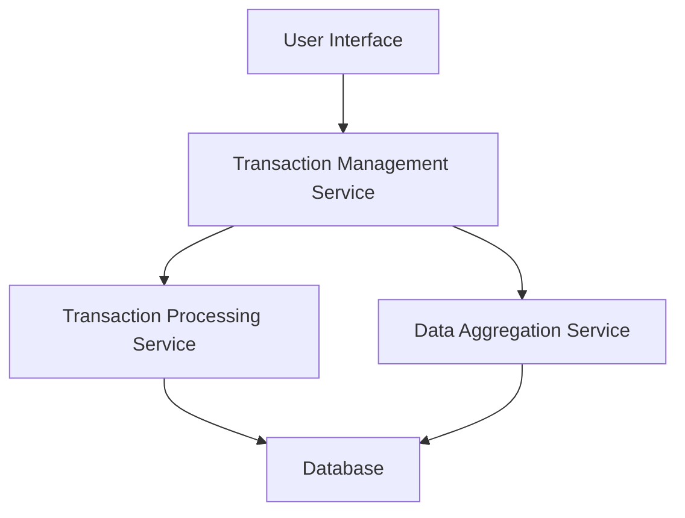

#### 1. High-Level Design

- **Summary:** This epic delivers a comprehensive transaction tracking system that enables users to view detailed transaction histories across multiple credit cards and analyze monthly spending trends. The system aggregates transaction data from all cards, presents it in a unified interface, and provides time-based visualizations to help users understand spending patterns over a 12-month period.

- **Component Flow:**

- **Integration Points:**
  - **Upstream:** Transaction Processing Service (provides raw transaction data from credit card systems)
  - **Downstream:** Data Aggregation Service (computes monthly trends and spending summaries)
  - Database layer for persistent storage of transaction history

- **Key Assumptions:**
  - Transaction data is provided in a standardized format by the Transaction Processing Service with fields such as transaction ID, date, amount, merchant, category, and card ID.
  - Monthly trend calculations are performed asynchronously and cached to meet the 500ms query performance requirement.

- **NFR Highlights:** System must support 12 months of transaction history display; transaction queries must return results within 500ms; pagination support required for large transaction volumes.

- **Data Flow:** User requests transaction data through the UI → Transaction Management Service queries the Transaction Processing Service for raw transaction records → Data is retrieved from the Database → Data Aggregation Service computes monthly trends by grouping transactions by month and card → Aggregated results and transaction lists are returned to the UI → User views paginated transaction history and monthly trend visualizations (charts showing spending patterns over time).

#### 2. Validation Report

- **Requirements Coverage:** The design fully covers the epic's stated scope including transaction listing, monthly trend visualization, transaction history tracking, time-based analysis, multi-card aggregation, and trend comparison. The architecture supports all NFRs (12-month history, 500ms query performance, pagination) through the separation of concerns between transaction retrieval and aggregation services, with caching strategies for performance optimization.