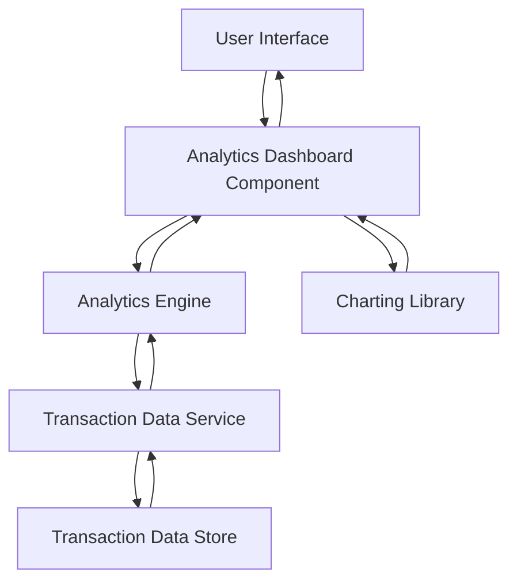

#### 1. High-Level Design

- **Summary:** This epic delivers interactive analytics and visualization capabilities that enable users to understand spending patterns across different categories (Food & Dining, Fuel, Shopping, Travel, Entertainment, Utilities, Healthcare, Education, Miscellaneous) and time periods. Users can view monthly spend trends, analyze category-wise breakdowns, and interact with charts and graphs to identify spending patterns and improve financial wellness.

- **Component Flow:**

- **Integration Points:**
  - **Upstream:** Transaction data service for retrieving historical transaction records and spending data
  - **Downstream:** Analytics engine for data aggregation, categorization, and calculation; charting library for interactive visualization rendering

- **Key Assumptions:**
  - Transaction categorization is pre-processed and stored with each transaction record
  - Historical data retention is limited to 12 months as per NFR specification

- **NFR Highlights:** Analytics visualizations must render within 2 seconds; system must process and display transaction data for up to 12 months of history; charts must be interactive and responsive across all device types

#### 2. Validation Report

- **Requirements Coverage:** The design comprehensively covers the epic's scope including category-wise spending visualization, monthly spend trend analysis, interactive charts and graphs, transaction data aggregation, spending pattern identification, and multi-category breakdown. The architecture incorporates the analytics engine, transaction data service, and charting library dependencies specified in the epic, ensuring actionable insights and data-driven financial decision-making capabilities.