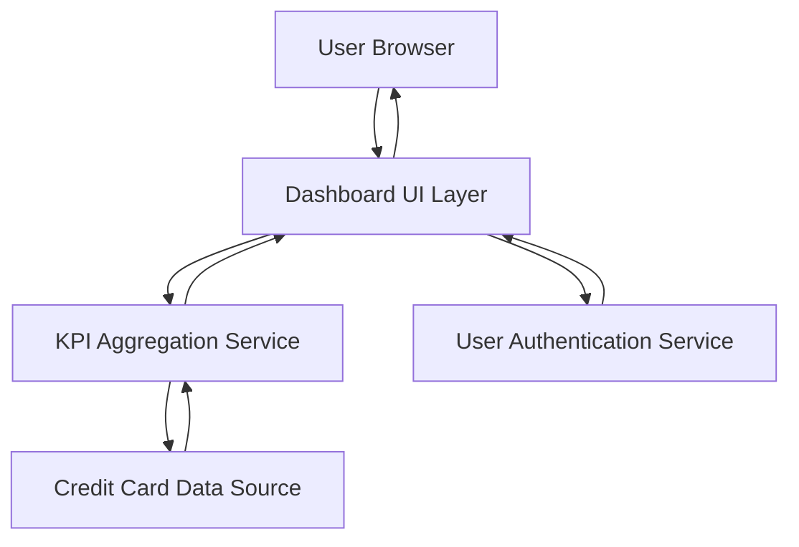

#### 1. High-Level Design

- **Summary:** This epic delivers a consolidated dashboard that displays key performance indicators (KPIs) for all user credit cards in a single, responsive interface. Users can monitor monthly spend, total credit limit, available credit, and outstanding amounts across all cards, enabling centralized financial visibility and informed decision-making.

- **Component Flow:**

- **Integration Points:**
  - **Upstream:** User authentication service for secure access and session management
  - **Downstream:** Credit card data source or mock data service for retrieving card balances, limits, and transaction data

- **Key Assumptions:**
  - KPI calculations (available credit, credit utilization) are performed server-side and cached for performance
  - Data refresh frequency is not real-time; periodic polling or manual refresh is assumed

- **NFR Highlights:** Dashboard must load within 2 seconds under normal network conditions; support responsive layouts for desktop, tablet, and mobile devices; handle concurrent viewing of up to 10 cards per user

#### 2. Validation Report

- **Requirements Coverage:** The design fully covers the epic's stated scope including dashboard KPI display, monthly spend tracking, total credit limit aggregation, available credit calculation, outstanding amount monitoring, responsive UI design, and multi-card consolidated view. The component flow addresses data retrieval, aggregation, authentication, and presentation layers necessary to deliver the consolidated dashboard experience.