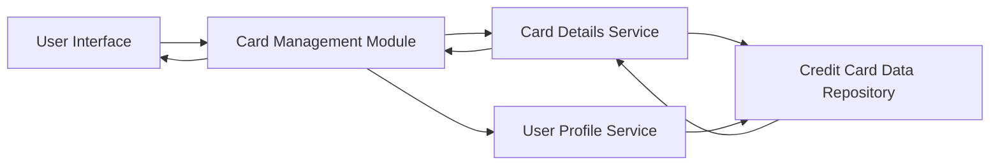

#### 1. High-Level Design

- **Summary:** This epic enables users to view and manage multiple credit cards within the dashboard, providing individual card details, side-by-side comparison capabilities, and card-specific information such as card type, issuer, credit limit, and current balance. Users can drill down into specific card performance and usage patterns for optimized credit portfolio management.

- **Component Flow:**

- **Integration Points:**
  - **Upstream:** User profile service for card ownership validation and user-card association
  - **Downstream:** Credit card data repository for retrieving card metadata, balances, limits, and transaction history

- **Key Assumptions:**
  - Card comparison logic is implemented client-side for responsive interaction
  - Card metadata (type, issuer) is stored separately from transactional data

- **NFR Highlights:** System must support display of up to 10 credit cards per user account; card data refresh should occur within 3 seconds; interface must maintain performance with multiple cards loaded simultaneously

#### 2. Validation Report

- **Requirements Coverage:** The design addresses all aspects of the epic's scope including multiple credit card display, individual card details view, card-wise spend analysis, card comparison capabilities, and card metadata management. The component architecture supports user validation, data retrieval, and presentation of multiple cards with drill-down capabilities as specified in the epic requirements.