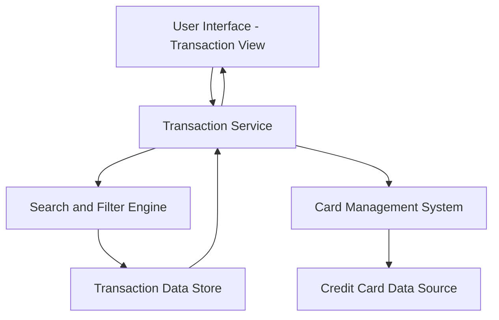

#### 1. High-Level Design

- **Summary:** This epic enables users to view and manage credit card transactions across all their cards. Users can access detailed transaction history, filter and search transactions, and review spending activity. The solution supports multiple credit cards with an intuitive, responsive interface for quick access to transaction details on any device.

- **Component Flow:**

- **Integration Points:**
  - **Upstream:** Credit Card Data Sources (provides transaction data)
  - **Upstream:** Card Management System (associates transactions with specific cards)
  - **Downstream:** Provides transaction data to Analytics module for spending pattern analysis

- **Key Assumptions:**
  - Transaction data is stored in a centralized Transaction Data Store after being retrieved from credit card data sources; synchronization frequency not specified.
  - Pagination is implemented with a default page size (e.g., 50 transactions per page) to handle large transaction volumes; specific page size not defined in epic.

- **NFR Highlights:** Transaction list must load within 3 seconds for up to 1000 transactions; system must support pagination for large transaction volumes; search and filter operations must complete within 1 second.

- **Data Flow:** User accesses the Transaction View through the User Interface, which calls the Transaction Service. The Transaction Service queries the Card Management System to identify all cards associated with the user and retrieves card-to-transaction mappings from the Credit Card Data Source. Transaction details are fetched from the Transaction Data Store. When users apply filters or search, the Search and Filter Engine processes the query against the Transaction Data Store and returns filtered results within 1 second. The Transaction Service formats the data with pagination support (handling up to 1000 transactions in 3 seconds) and sends it to the User Interface for display. Users can drill down into individual transactions to view detailed information.

#### 2. Validation Report

- **Requirements Coverage:** The design addresses all scope elements including transaction listing, transaction viewing, multi-card transaction support, transaction details display, and responsive transaction interface. All NFRs are covered: 3-second load time for up to 1000 transactions through efficient data retrieval and pagination, pagination support for large volumes via the Transaction Service, and 1-second search/filter performance through the dedicated Search and Filter Engine. Integration dependencies with credit card data sources and card management system are explicitly addressed in the architecture. Out-of-scope items (real bank integration, card payments, fund transfers, payment gateway integration, transaction disputes, transaction categorization editing) are excluded from the design as specified in the epic.