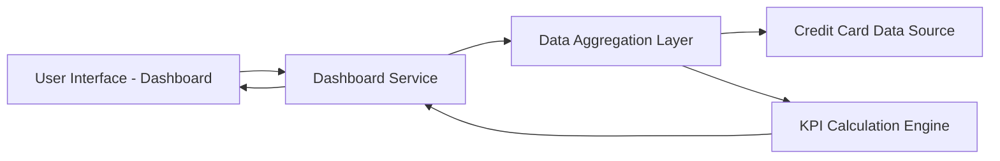

#### 1. High-Level Design

- **Summary:** This epic provides a consolidated dashboard displaying key performance indicators for the user's credit card portfolio. The dashboard shows monthly spend, total credit limit, available credit, and outstanding amounts across multiple credit cards in a single, modern, responsive interface. Users gain immediate visibility into their overall credit status and financial health.

- **Component Flow:**

- **Integration Points:**
  - **Upstream:** Credit Card Data Sources (provides card details, balances, credit limits)
  - **Downstream:** Provides aggregated KPI data to Analytics and Transaction modules for consistency

- **Key Assumptions:**
  - Credit card data is retrieved via API calls to external credit card data sources; data ownership and access permissions are managed externally.
  - "Near real-time" data refresh means data is updated within 5 minutes of actual changes; specific refresh interval not defined in epic.

- **NFR Highlights:** Dashboard must load within 2 seconds; system must support responsive design across desktop, tablet, and mobile devices; data refresh rate must be near real-time or clearly indicated if delayed.

- **Data Flow:** User requests dashboard view through the User Interface, which calls the Dashboard Service. The Dashboard Service invokes the Data Aggregation Layer to retrieve current credit card data from Credit Card Data Sources (card details, balances, limits). The Data Aggregation Layer fetches data for all user's cards and passes it to the KPI Calculation Engine, which computes monthly spend, total credit limit, available credit (limit minus outstanding), and outstanding amounts. Calculated KPIs are returned to the Dashboard Service, which formats the data and sends it to the User Interface for display in a responsive layout.

#### 2. Validation Report

- **Requirements Coverage:** The design fully covers the stated scope including dashboard KPIs display, monthly spend tracking, total credit limit aggregation, available credit calculation, outstanding amount display, multiple credit card management, consolidated credit card view, and responsive layout design. The architecture addresses all NFRs: 2-second load time through efficient data aggregation, responsive design support across devices via adaptive UI components, and near real-time data refresh with clear indicators. The integration dependency with credit card data sources is explicitly addressed. Out-of-scope items (real bank integration, card payments, fund transfers, loans, payment gateway integration) are excluded from the design as specified.